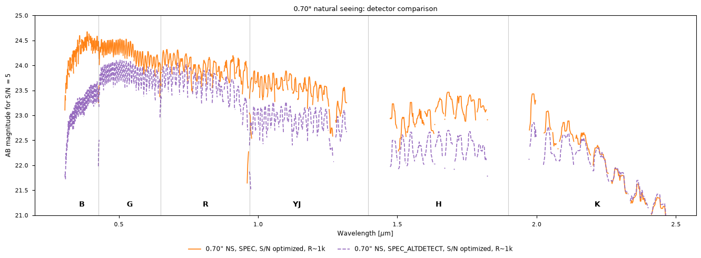

# ZShooter detector operating points

`SPEC` and `SPEC_ALTDETECT` select complete, editable detector packages in IRDB. In the current configuration, the alternative uses untapered CCDs in B/G/R and 18 um H2RGs in YJ/H/K. These are engineering choices for this comparison, not permanent meanings of the mode names. QE, physical pitch, dark current, effective read noise and usable well come from that configuration. The comparison simulates and extracts each package instead of rescaling the original detector samples by a QE ratio.

```python
commands = scopesim.UserCommands(use_instrument="ZShooter_v2", set_modes=["SPEC_ALTDETECT"])
train = scopesim.OpticalTrain(commands)
```

Construct a new train after editing or switching detector packages: pitch and QE enter effect initialization. Rerun calibration and standard cells with `overwrite_cals=True` after a package edit, including edits that retain the mode name. The existing reuse checks detect mode/geometry mismatches; rebuilding also covers changes to QE and operating points. Slit/exposure changes within a prepared package retain the existing ScopeSim update/readout interface.

## Configured engineering points

| Package and channels | Detector | Pitch [um] | Effective RN [input e RMS/integration] | Dark [input e/hour/pixel] | Photon variance factor F | Avalanche gain M | Usable input well [e/integration] |
|---|---|---:|---:|---:|---:|---:|---:|
| SPEC B/G/R | tapered qCCD | 15 | .1 | .5976 | 1 | 1 | 60,000 |
| SPEC YJ/H/K | LmAPD | 15 | .5 | .36 | 1.2 | 10 | 15,000 |
| SPEC_ALTDETECT B/G/R | untapered CCD | 15 | 2.5 | 2 | 1 | 1 | 60,000 |
| SPEC_ALTDETECT YJ/H/K | H2RG | 18 | 6 | 23 | 1 | 1 | 60,000 |

These are design inputs, not measured vendor specifications. Per-arm properties live in `ZShooter_DET.yaml` and `ZShooter_ALTDETECT.yaml`, including `!DET.usable_well_h`, `!DET.ron_h`, `!DET.dark_h`, `!DET.excess_noise_factor_h` and `!DET.pixel_size_h`. The qCCD low RN remains a specified effective operating point; its sampling time has not been specified.

Pixel counts remain 2048 x 4096 in B/G/R and 2048 x 2048 in YJ/H/K. An H2RG therefore covers 36.864 mm rather than 30.72 mm in each direction. Physical optics, order numbers and offsets stay fixed. YJ/H/K gain focal-plane coverage and use fewer detector pixels per physical resolution element. YJ retains its omitted red order 57. Degree-six trace fits with seven slit samples keep the mapping consistent over the larger coverage. Tests compare all 125 orders at common physical coordinates between pitches, to 0.01 of the smallest configured pixel. Detector tests compare effects and headers against the loaded IRDB commands; they do not freeze these engineering values.

## Explicit exposure settings

Each notebook defines exposure settings near the beginning. NDIT counts independent integrations or ramps, not samples within a ramp. There is **no automatic increase of NDIT**, adjustment of DIT, or saturation clipping. Readout checks expected source + optical background + dark charge per integration, after CCD charge binning, and warns if it exceeds the configured usable limit. `PEAKDIT` and `WELLDEP` record the check in the image header. The accumulated image may exceed one well when each contributing integration is below its limit.

| Package/channel | Five minutes | One hour |
|---|---|---|
| Either package, B/G/R | 300 s x 1 | 1200 s x 3 |
| SPEC YJ LmAPD | 100 s x 3 | 100 s x 36 |
| SPEC_ALTDETECT YJ H2RG | 300 s x 1 | 300 s x 12 |
| SPEC H LmAPD | 30 s x 10 | 30 s x 120 |
| SPEC K LmAPD | 60 s x 5 | 60 s x 60 |
| SPEC_ALTDETECT H H2RG | 75 s x 4 | 90 s x 40 |
| SPEC_ALTDETECT K H2RG | 150 s x 2 | 150 s x 24 |
| X-shooter UVB/VIS | 300 s x 1 | 1200 s x 3 |
| X-shooter faint NIR | 300 s x 1 | 300 s x 12 |
| X-shooter high NIR | 300 s x 1 | 450 s x 8 |

Kilonova science, standard and calibration DITs are likewise explicit. Their sky/scene differs from flat AB, so their own peak tables are the relevant checks. An extraction mask cannot make the incoming OH peaks safe for the detector.

The flat-AB wide-slit SPEC H/K peaks are 11,442/12,341 e per integration (76.3%/82.3% of usable well). Alternative H2RG H/K peaks are 49,412/43,725 e (82.4%/72.9%). The [earlier comparison peak table](../validation/xshooter/data/comparison/saturation.csv) used LmAPD YJ in both packages, with a 6,962 e peak. In the user's completed performance rerun with H2RG YJ, its largest peak across both durations and all three slit/seeing cases is **30,386 e per integration, 50.64% of its 60,000 e configured limit**. The [revised performance exposure table](../validation/xshooter/data/detector_packages/alternate_yj_h2rg_performance_exposures.ecsv) preserves those measurements. These explicit cadences replace the earlier operationally infeasible 1800-second NIR forecasts.

The performance rerun uses the revised package. SPIE and flat-AB comparison notebook settings have been updated, but their saved figures still show the preceding YJ LmAPD configuration and are labelled accordingly. Their reruns are needed before interpreting a new YJ detector-trade curve. Comparison mode selection is now an explicit setting alongside the primary mode; no binary toggle infers the other mode.



This is the completed performance notebook's one-hour, .70 arcsec natural-seeing comparison, with its existing OH selection and nominal R approximately 1000 binning. It preserves that notebook's plotting and extraction conventions; the separate flat-AB comparison uses measured line-width matching.

X-shooter CCD checks convert the manual's 65,000 ADU ceiling using the configured gain; NIR retains the adopted conservative 89,000-electron limit. Native NIR outputs average NDIT, while CCD outputs sum them; prepared reduction inputs convert the actual outputs to accumulated electrons. Sources: [ESO manual, Table 9](https://www.eso.org/sci/facilities/paranal/instruments/xshooter/doc/VLT-MAN-ESO-14650-4942_P114v1.pdf) and [NIR readout note](https://www.eso.org/sci/facilities/paranal/instruments/xshooter/doc/reportNDreadoutpublic.pdf).

## Physical QE and avalanche variance

The historical `APD_TER.dat` equals `H2RG_TER.dat / 1.2`. That was a photon-noise sensitivity approximation, not an independently specified APD QE. Both packages now use `H2RG_TER.dat` as the common **assumed physical NIR QE**, with F=1.2 applied to LmAPD photon variance. This inherited estimated curve needs a vendor-specific replacement when available. The current YJ comparison shares that assumed QE but changes detector pitch, read noise, dark current, photon variance and exposure cadence.

Relative to the old proxy, LmAPD mean photon counts increase by 20%. Photon-dominated sensitivity is unchanged: physical signal and photon variance increase in the required ratio. Read noise is no longer indirectly penalized by reducing signal, and physical charge is available for the well check.

For accumulated source electrons S, optical background B, dark D, integration count N and effective input RN r, independent equal-time blank subtraction gives

\[
V = F S + 2\left(F B + D + N r^2\right).
\]

Optical thermal photons belong in B. Dark uses the specified independent input-referred mean/Poisson variance. Effective RN is already input referred and is not divided by M again. This preserves the operating distinction you described: downstream read noise is independent of avalanche multiplication, and graded detectors can leave dark signal largely unamplified. [Huber et al. (2026), Sections 2.2-2.3](https://arxiv.org/html/2610.00799v1#S2.SS2) describe those mechanisms. Our dark term remains a simple engineering noise prescription, without a separate layer-by-layer charge-generation model.

Science frames draw photon, dark and read fluctuations. The LmAPD photon distribution is compound Poisson/gamma, with input-referred mean mu and variance F mu; F=1 gives ordinary Poisson. This supplies the desired first two moments without modelling ramps. Performance expected-rate frames omit random draws; their extraction variance includes the same photon, dark and N-read terms.

ZShooter outputs stay in input-referred electrons. Header avalanche gain describes the operating point and is not a second signal multiplication. ADC conversion/bias have not been assigned vendor values. For output conversion g in output electrons/ADU, photon mean and variance would be M(S+B)/g and M^2 F(S+B)/g^2. Gain-one electron storage is not a measured electronics gain.

## Reduction and verification

The DRP receives an expected pixel-variance image and uses configured trace geometry and detector WCS. Kilonova calibration directories include the detector mode. Reuse also checks saved mode, detector dimensions and physical WCS; a mismatch requires rebuilding calibrations.

The alternative package uses the separately simulated 2 arcsec illuminated-slit trace frames in every channel. The untapered CCD response made the old full-slit-flat settings merge BLUE orders and split GREEN orders. Mode-specific trace settings recover the configured 34 BLUE, 30 GREEN, 20 RED, 10 H and 8 K orders without duplicates. BLUE retains all 34 orders when its trace threshold is varied from 30 to 300 electrons. These settings belong to the DRP's `settings_SPEC_ALTDETECT.yaml`, selected from the calibration frame's `DETMODE` header. The revised YJ H2RG uses the same short-slit trace settings as H/K, with explicit **3 s arc and 1.2 s flat/trace exposures**. Changing a detector's pitch invalidates its old calibration WCS; rebuild those files even when the mode name has stayed the same.

The fresh validation exposed a file-selection error before science extraction: PyReduce returned a calibration-only night before the night containing the standard and flat-AB science frames. Selecting `file_groups[0]` therefore yielded no science spectra and `KeyError: 'STANDARD'`. Both the validation and kilonova notebooks now select the single group containing science frames. Zero or multiple such groups fail directly instead of silently selecting one. The actual file-group check selects the standard and flat-AB source in all six channels; frame data are unchanged.

A separate existing parameter-forwarding issue explains the dates in these frames: `update_params_and_observe` filters `params` to keys already present in `UserCommands`. The default ZShooter commands have no `!OBS.mjdobs` key, so the requested MJD 60310.25 is discarded and the atmosphere resolves a date from `brightness="dark"`. These kilonova-derived validation frames therefore use the resolved dates, rather than that requested fixed epoch. Correcting the parameter forwarding and regenerating affected kilonova frames is a separate follow-up for comparisons that require a common epoch.

The initial 2 s H2RG YJ arc failed its curvature fit in order 76, near 1 um, and PyReduce substituted zero slit tilt. The previous LmAPD calibration and neighbouring orders have a tilt near .084 pixel per spatial pixel. An explicit 3 s arc restores order 76 to .08305 while the other orders remain near .085; the [controlled exposure comparison](../validation/xshooter/data/detector_packages/yj_arc_curvature_trial.ecsv) records every order. Its peak is 50,221 e, 83.7% of the configured well. This is the reason for increasing the manual calibration DIT, rather than accepting that warning as a successful calibration.

With that calibration, the revised alternative package recovers flat-AB band flux ratios of .9980, 1.0014, 1.0002, .9880, 1.0006 and 1.0110 in B/G/R/YJ/H/K. All six are within 1.1 propagated standard deviations of unity; YJ is .9880 +/- .0168. The [band measurements](../validation/xshooter/data/detector_packages/alternate_yj_h2rg_flat_ab_bands.ecsv) and [recovery plot](../validation/xshooter/data/detector_packages/alternate_yj_h2rg_flat_ab_recovery.png) retain the uncertainties and individual integration bins. A separate check across the affected order 76 gives **1.026 +/- .018** ([measurement](../validation/xshooter/data/detector_packages/yj_order76_flux.ecsv), [plot](../validation/xshooter/data/detector_packages/yj_order76_recovery.png)). These are flat-AB reduction controls, not a new three-epoch kilonova run.

The revised run measures 34/30/20/22/10/8 orders in B/G/R/YJ/H/K, again leaving the partially covered YJ order 80 outside the trace set. Median absolute wavelength-fit residuals range from .016 to .035 native pixels. YJ now uses 136 accepted arc lines, with median/p95 residuals .017/.060 pixels. The [calibration table](../validation/xshooter/data/detector_packages/alternate_yj_h2rg_calibration.csv) and [measured traces](../validation/xshooter/data/detector_packages/alternate_yj_h2rg_measured_traces.png) show the result. The [exposure table](../validation/xshooter/data/detector_packages/alternate_yj_h2rg_exposures.csv) includes both the initial `arcs` exposure and the adopted `arcs_3s` trial; the executed [validation notebook](../validation/xshooter/Detector_Package_Reduction.ipynb) preserves that sequence. The production kilonova notebook starts directly with the 3 s setting.

The current SPEC kilonova run passes its six flat-AB flux controls: recovered/input ratios are .9989, .9995, .9976, .9697, 1.0297 and 1.0151 in B/G/R/YJ/H/K. Independent blank differences have standardized standard deviations .9996–1.0004; illuminated source-minus-blank residuals give .9988–1.0012. The [saved control measurements](../validation/xshooter/data/detector_packages/spec_flat_ab_bands.ecsv) include propagated uncertainties.

The preceding alternative-package reduction, with LmAPD YJ, simulated and reduced separate calibrations, a standard and a flat-AB source in all six channels. Its recovered/input ratios were 1.0043, .9984, .9951, 1.0021, .9890 and 1.0276; each was within 1.5 propagated standard deviations of unity. Those [flux measurements](../validation/xshooter/data/detector_packages/alternate_flat_ab_bands.ecsv), [recovery plot](../validation/xshooter/data/detector_packages/alternate_flat_ab_recovery.png) and [per-integration charge checks](../validation/xshooter/data/detector_packages/alternate_exposures.csv) are retained as a configuration snapshot.

In that preceding run, both packages recovered 22 YJ orders: the short, partially covered blue order 80 remained outside the measured trace set. The other five channels recovered all configured orders, giving 124 measured orders in each package. This is distinct from the 125-order optical-geometry test. The alternative's median absolute wavelength-fit residuals were .018–.032 native pixels across the channels; the retained [calibration measurements](../validation/xshooter/data/detector_packages/alternate_calibration.csv) and [measured traces](../validation/xshooter/data/detector_packages/alternate_measured_traces.png) show that coverage.

One separate reduction failure remains explicit: the 20-day SPEC BLUE scene does not converge in the fitted-profile uncertainty calculation. The 1.5- and 7.5-day scenes extracted in all six channels. In the failed swath the fitted spatial profile has large cancelling positive and negative terms; increasing the uncertainty solver from 40 to 400 iterations did not resolve it. The detector patch does not replace that estimator with a fixed profile, change the random realization to avoid it, or assign a substitute uncertainty. This is a faint-source extraction question, not a failed detector well or photon-variance check.

The X-shooter rerun likewise completes all simulated frames and both modes' 1.5- and 7.5-day extractions, then stops at the 20-day faint-mode UVB uncertainty solve. Its independent-blank standardized deviations are .99936–1.00046; source-minus-blank deviations are .99769–1.00263. Maximum NIR charge is 72,769 e/integration in faint mode and 78,852 e in high mode, below 89,000 e. [Peak charges](../validation/xshooter/data/detector_packages/xshooter_peaks.csv), [exposure settings](../validation/xshooter/data/detector_packages/xshooter_exposures.csv) and [noise checks](../validation/xshooter/data/detector_packages/xshooter_flat_ab_pixel_noise.csv) record these detector checks.

Its **faint-mode NIR flux control fails**. The retained-window recovered/input ratio is 4692, dominated by localized spikes near 2.268 um; this is an invalid calibrated spectrum. The saved flat normalization has 212 samples with blaze exactly 1, including that region, and the standard's blaze-corrected counts jump there too. [Affected calibration samples](../validation/xshooter/data/detector_packages/xshooter_faint_unity_blaze_samples.csv) and the [unclipped recovery plot](../validation/xshooter/data/detector_packages/xshooter_faint_flat_ab_recovery.png) preserve the failure. The origin of those calibration values still needs repair; no samples were silently excluded to improve closure. The other five mode/arm controls recover 1.0069, 1.0036 (faint UVB/VIS), and 1.0002, .9939, .9851 (high UVB/VIS/NIR); [all values and uncertainties](../validation/xshooter/data/detector_packages/xshooter_flat_ab_closure.ecsv) are saved. The new three-epoch kilonova figures have not been regenerated. These two notebook runs are not counted as full scientific-validation passes.

Targeted tests cover avalanche mean/variance, independent arm RNG draws, unaffected dark variance, independent-read accumulation, electron/ADU and sum/average conversions, well warnings without parameter mutation, physical trace invariance and calibration reuse. Notebook reruns supply full-frame peak and extraction checks.

## Performance-cell runtime

The alternative-detector cell in `zshooter_performance.ipynb` performs four observations for each of three slit/seeing cases: source plus background and blank background, with and without OH emission. That is **twelve full optical renders**, followed by six exposure/extraction analyses. Its progress print was at the end of each complete case; both performance notebooks now print cumulative elapsed time after each render and before each extraction case. At 60--90 s per observation, the rendering alone takes 12--18 minutes.

During the user's run, a native process sample showed one busy CPU, with substantial time in polynomial powers, geometric interpolation and array movement. Memory pressure was normal at that sampling time, so the observed CPU-bound interval was not explained by swapping. The six retained alternative `samples_raw` tables total about 263 MiB; they alone do not explain the kernel's much larger memory footprint. After the notebook finished, an isolated train profiled the current alternative package at .33 arcsec with AO and full sky, preserving the user's train and results:

| Operation | Instrumented elapsed time [s] |
|---|---:|
| Trace diagnostics | 4.80 |
| Source plus background observation/readout | 147.86 |
| Blank background observation/readout | 145.75 |
| Paired extraction and aggregation | 26.88 |
| Aggregation repeated alone to isolate its cost | 13.21 |

The [saved timings](../validation/xshooter/data/detector_packages/alternate_cell_profile.csv) are from `cProfile`, which adds overhead; these are diagnostic measurements, not an uninstrumented runtime acceptance result. The standalone aggregation repeats work contained in paired extraction and must not be added to it. In the source profile, focal-plane mapping accumulated 52.8 s and PSF application 47.0 s. Paired extraction spent 10.3 s constructing Astropy tables; its aggregation repeatedly created columns and accessed row metadata. [Selected function timings](../validation/xshooter/data/detector_packages/alternate_cell_profile_functions.csv) preserve these attribution measurements; nested cumulative times are not additive. The twelve renders dominate the cell, with table processing an additional, tractable cost.

The separate unprofiled .70 arcsec natural-seeing reduction validation completed its full-sky source and blank calls in 105.7 and 91.1 s. Those helper timings include setup, observation, readout and saving FITS files. Their PSF and scene differ from the AO profile above.

Recommended next work, in order:

1. Keep extraction arithmetic in NumPy arrays and construct output tables once. Compute each cumulative sum once per trace, outside the loop over bin factors. This is local reuse of unchanged arrays, without a persistent cache. Verify identical extraction windows, counts, variances and sensitivity.
2. Benchmark polynomial evaluation in the shared projection code using Horner-style array evaluation, retaining the current transforms and precision. Validate all trace mappings, photon integrals, widths and centroids before adopting it.
3. Investigate reducing repeated optical work only after demonstrating that source-only and background projections use compatible grids and linear operations. Adding separately rendered rate images is not automatically equivalent in this PSF/slit path.

No projection algorithm, sampling resolution or scientific cache has been changed as part of this YJ follow-through. Full-notebook parallelism would increase memory pressure on this workstation; it is not the first speed improvement to pursue.

## Memory during validation

The 2026-10-20 concurrent-run snapshot found ten kernels on the project server (port 8888), with about 86 GiB of macOS-reported footprint on the 64 GiB workstation. SPIE used 29.1 GiB, the active performance rerun 23.0 GiB, X-shooter kilonova 11.3 GiB, alternate-detector reduction 6.9 GiB and flat AB 6.1 GiB. Five idle kernels retained another 9.2 GiB. The DRP server on port 8889 had no sessions. [All kernel measurements](../validation/xshooter/data/detector_packages/kernel_memory.csv) include resident size and peak footprint.

Resident RAM alone substantially understated these allocations because macOS had compressed or paged much of them out. The system reported warning-level pressure. Over 63 seconds, swap writes averaged 47.5 MiB/s and compression processed about 433 MiB/s; swap use reached 42.5 GiB. These system-wide rates demonstrate active pressure, rather than merely an old swap file. Running several full validations concurrently was a poor scheduling choice. Heavy notebooks should run serially, and completed validation kernels should be closed after saving outputs. The active user performance run is left intact. The full per-case analysis tables also merit a focused memory review before expanding the trade grid further.

After saving and closing the flat-AB, SPIE, alternative-reduction and X-shooter validation kernels, system pressure returned to normal. At 22:04 UTC, the [remaining six kernels](../validation/xshooter/data/detector_packages/kernel_memory_after.csv) comprised the active performance notebook (13.3 GiB footprint) and the five idle notebooks (about 9.3 GiB). Swap use had fallen to 17.3 GiB. Remaining swap allocation need not immediately disappear after pressure falls. None of the user's existing idle kernels or active performance kernel was stopped.

The subsequent YJ H2RG reduction ran by itself after the user's performance run finished. Its validation kernel was closed after saving the results. The final system check reports normal memory pressure, with 16.4 GiB of swap still allocated; the user's completed performance kernel remains alive. This supports keeping heavy notebook runs serial and closing validation kernels once their saved outputs are sufficient.

For vendor discussions, specify physical QE; bias/temperature and M; F explicitly as a variance multiplier; effective RN for the completed integration; dark mean/variance in stated input/output units; usable well at that gain and accepted nonlinearity; ADC conversion/range; and reset/read overheads. CCD charge-binning limits and qCCD sampling time also need specifications. Until overheads are specified, reported durations are on-source integration time. An independent equal-time blank adds the same sky integration time before overheads.
