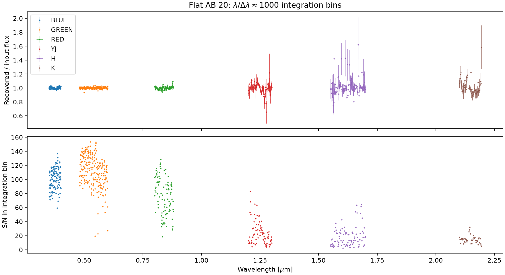
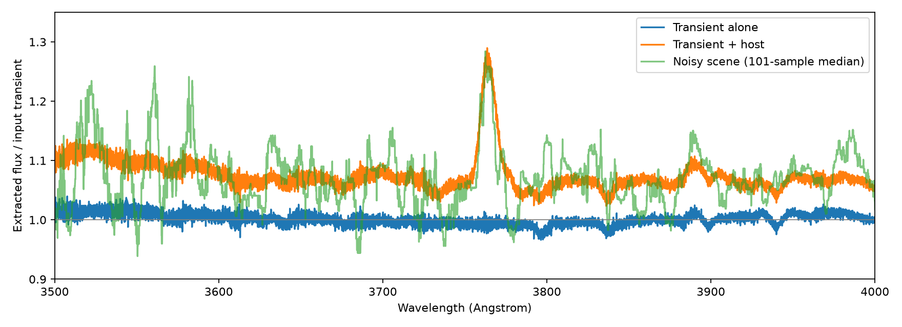
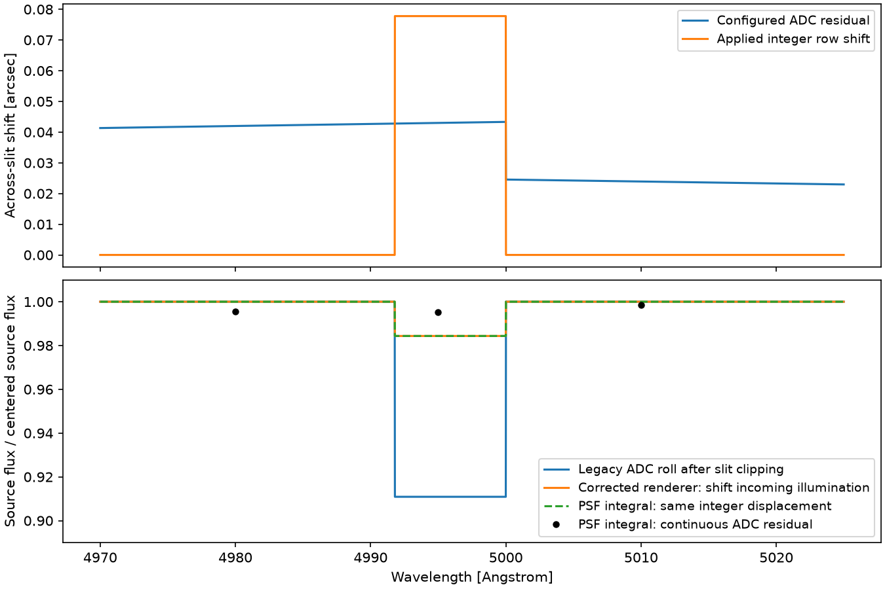
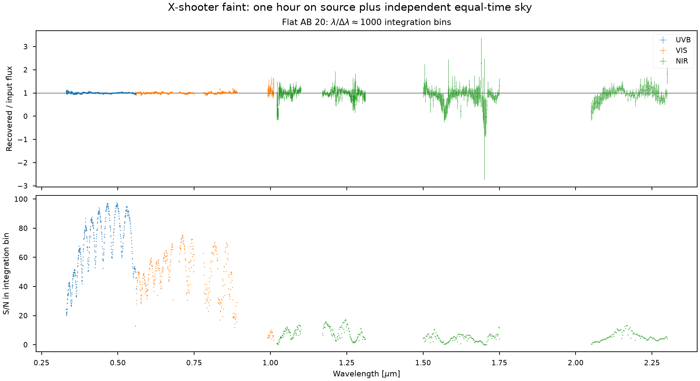
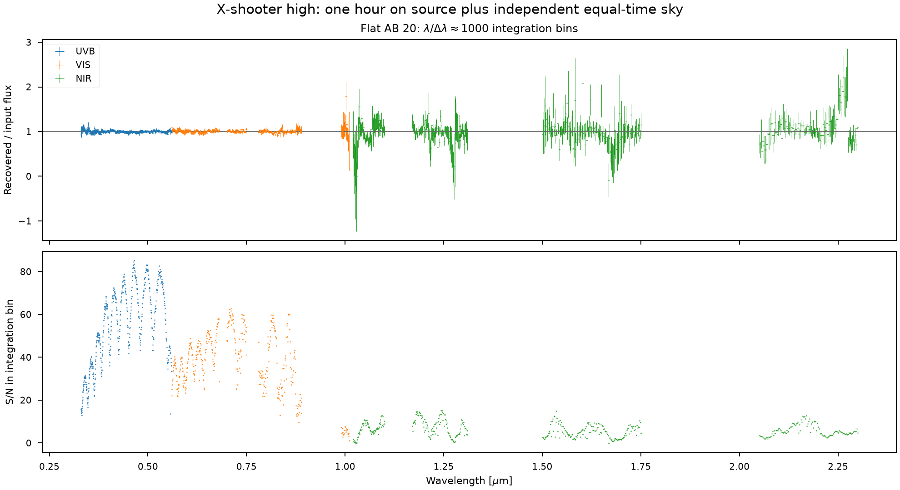
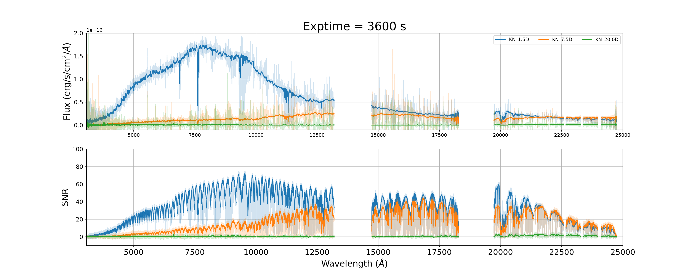
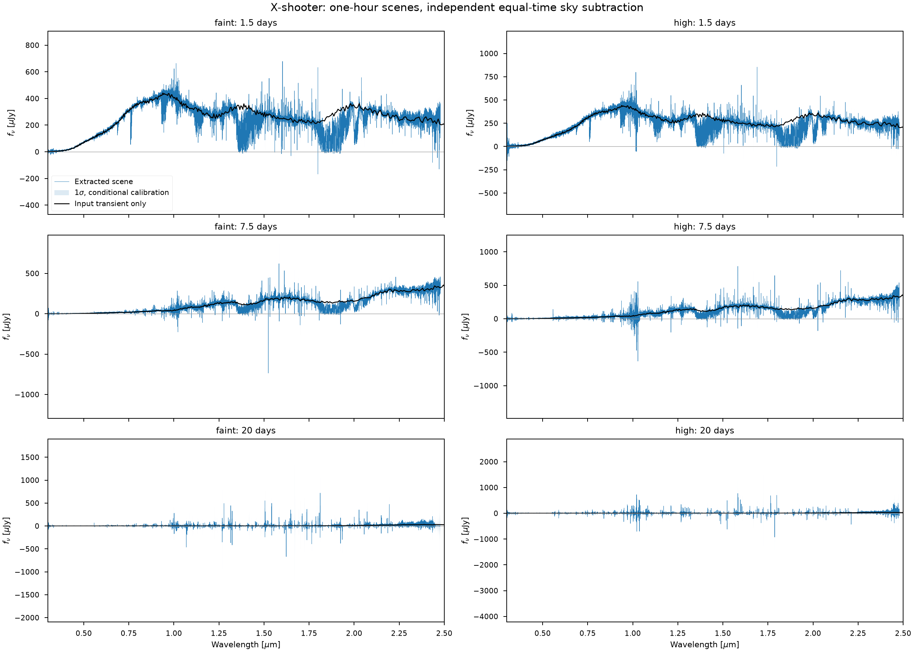

# Mirrored kilonova reductions

The two worked examples are [ZShooter](../notebooks/01_Kilonovae.ipynb) and
[X-shooter](../notebooks/01_Kilonovae_XSHOOTER.ipynb). Both begin with a flat AB
continuum control before interpreting the 1.5-, 7.5- and 20-day kilonova scenes.
The scenes include the host galaxy. Extracted scene flux divided by the input
transient alone is therefore not a flux-conservation test; the previous BLUE
excess is explained in the [host-light investigation](../../zshooter-drp/docs/source/kilonova-reduction-repair.md).

Both notebooks completed all three epochs: 18 ZShooter channel/epoch products
and 18 X-shooter mode/arm/epoch products, plus their flat-AB controls. The saved
frames and plots form the **pre-ADC-correction baseline**, generated with
ScopeSim `a0495f7`. The separate ADC correction discussed below must not be
inferred to have been exercised by these archived frames.

Both notebooks use the same evaluated atmospheric transmission and sky curves,
dark conditions, airmass 1.3, seeing 0.7 arcsec and MJD 60310.25. These preserve
the kilonova example's conditions; the separate performance comparison uses
airmass 1.1 and seeing 0.65 arcsec. X-shooter's original SkyCalc effects are
disabled when the common evaluated curves are installed.

| Case | Slits [arcsec] | Spectral CCD binning | One-hour on-source integrations |
|---|---|---|---|
| ZShooter natural seeing | 0.7 in all channels | 1 | 1800 s x 2 |
| X-shooter faint continuum | UVB/VIS/NIR: 1.0/0.9/0.9 | 2 | CCD: 1800 s x 2; NIR: 300 s x 12 |
| X-shooter higher resolution | UVB/VIS/NIR: 0.8/0.9/0.6 | 1 | CCD: 1800 s x 2; NIR: 450 s x 8 |

The NIR arrays remain unbinned. The higher-resolution X-shooter rate image
predicts 78,852 source-plus-optical-background electrons at the peak in 450 seconds, 11.4 percent below the
adopted 89,000-electron linearity limit. A 600-second integration would reach
105,136 electrons, so the starting 600 s x 6 cadence was shortened to 450 s x 8.
Faint-mode NIR reaches 53,843 electrons per 300-second integration. Dark current
adds 9 and 6 electrons respectively, without changing that conclusion. Each scene
has an independent equal-time sky observation; these exposure counts describe
on-source time, not total observing time.
This is an explicit per-integration count check; the X-shooter detector model
does not itself simulate saturation or nonlinear ramp response.

## What changed in the reduction

The science FITS inputs now contain accumulated electrons and an extension named
`VARIANCE` in electron squared. The variance comes from the actual simulated
source/background rate, dark current, effective read noise and integration
count. Native readouts are saved separately. Conversion from native X-shooter
ADU and averaged NIR products is reversed before combining exposures.

The notebooks combine the unique raw source and sky frames before extraction.
For example, two source exposures with separate equal-time sky exposures give
`A1 + A2 - B1 - B2` and variance `VA1 + VA2 + VB1 + VB2`. Reusing one sky instead
would require `A1 + A2 - 2*B` and `VA1 + VA2 + 4*VB`. The helper takes those
coefficients explicitly. `EXPTIME` records on-source time; an equal-time off-source
sky doubles observing time before read/reset overheads.
The combined `DIT` comes from the source integrations, even when a shorter sky
frame is listed first. Mixed source DITs fail explicitly because one `DIT/NDIT`
pair cannot describe them. The 23 targeted readout, helper and finite-bin tests
pass, including this metadata case and reused-sky variance.

PyReduce still fits its regularized spectrum and spatial profile with its
existing unweighted slit-decomposition estimator. Supplied pixel variances
determine propagated uncertainty; they do not change the fit weights. Spatial
Tikhonov regularization was already enabled: the spatial coefficient
`lambda_sf=0.1` scales the profile normal-matrix trace divided by the number of
profile samples; the separate spectral penalty is 1e-7. The earlier interpretation that
regularization had been disabled was incorrect. The revised uncertainty
calculation uses first-order, local Jacobian propagation. It differentiates the fitted profile as well as the spectrum and
combines overlapping swath responses before propagating detector variance.
The [mathematical note](../../PyReduce-xshooter/docs/extraction_uncertainty.md)
gives the equations and numerical checks.

Sparse spectral covariance is retained in FITS through flat/blaze correction,
response calibration, order cuts and stitching. ASCII files contain marginal
standard deviations only. A bin or integrated band must use the FITS covariance
and its actual weights. Fitting extra multiplicative offsets between noisy
overlaps is disabled on this covariance-aware path; the standard response sets
the flux scale.

The flat-AB figures use nominal wavelength integration bins with
`lambda / delta_lambda = 1000`; bins cut by gaps or window edges are narrower.
They test extracted flux and its uncertainty, without convolving the line-spread
function to a common resolution. The selected-window summary uses the full native
covariance across all retained samples, including correlations between bins.

These uncertainties describe detector fluctuations with the measured traces,
wavelength solution, calibration response, final rejection mask and selected
order/arm overlap junctions held fixed. Junctions are chosen using the fitted
marginal variances; uncertainty in that choice is not propagated.
Uncertainty in those calibration products needs separate calibration
realizations. Regularization bias is also separate from random variance.

The reduction changes and instrument orientation/order conventions are described
in the [DRP implementation note](../../zshooter-drp/docs/source/xshooter-reduction.md).
The PyReduce checkout used here is `~/src/PyReduce-xshooter`, based on release
0.9. The older, independently modified `~/src/PyReduce` checkout is untouched.

## Checks of the implemented calculation

The ZShooter flat-AB control gives the following integrated recovered/input flux
ratios. Uncertainties propagate the full spectral covariance while holding
calibration products fixed. Covered width excludes actual gaps between retained
samples; the requested RED and K intervals are not completely covered.

| Channel | Retained interval [Angstrom] | Covered width [Angstrom] | Recovered/input flux |
|---|---|---:|---:|
| BLUE | 3500--4000 | 499.92 | 1.00185 +/- 0.00124 |
| GREEN | 4800--6000 | 1199.95 | 1.00130 +/- 0.00091 |
| RED | 8000--8800 | 783.12 | 1.00157 +/- 0.00269 |
| YJ | 12000--13000 | 999.88 | 0.99417 +/- 0.01406 |
| H | 15500--17000 | 1499.92 | 1.02812 +/- 0.01852 |
| K | 21000--22000 | 896.98 | 1.02132 +/- 0.02130 |

[Numerical band results](../validation/xshooter/data/kilonova_reduction/zshooter_flat_ab_bands.ecsv),
[blank noise](../validation/xshooter/data/kilonova_reduction/zshooter_blank_noise.csv),
[source noise](../validation/xshooter/data/kilonova_reduction/zshooter_source_noise.csv)
and [arc checks](../validation/xshooter/data/kilonova_reduction/zshooter_calibration.csv)
are retained with this report. Independent checks of all six FITS products found
monotonic wavelengths, matching variance diagonals and saved marginal errors,
symmetric covariance and positive tested covariance quadratic forms.

The independent saved-product audit also checks all six channels at all three
epochs: physical flux/covariance units, 3600-second exposure, finite data,
positive marginal errors, matching covariance diagonals, symmetry and unchanged
wavelength coverage. Over 3500--4000 Angstrom, the integrated scene/transient
ratio is 1.0716 +/- 0.0052 at 1.5 days and 2.719 +/- 0.332 at 7.5 days.
These compare the host-plus-transient extraction with the transient alone.
At 7.5 days, 40 percent of the native BLUE samples in that window are negative;
the integrated scene S/N is 8.18. That value includes host light and cannot be
reported as the transient's detection significance.
The [saved-product check](../validation/xshooter/kilonova_product_check.py)
reproduces these quantities from the FITS covariance and the notebook's Kasen
input model. Its [numerical table](../validation/xshooter/data/kilonova_reduction/zshooter_kilonova_product_check.csv)
retains the wavelength coverage and native uncertainty distribution.
All 18 products pass those checks. At 20 days the selected-window scene S/N is
5.38, 12.73, 12.92, 2.26, 3.77 and 15.74 for BLUE through K. The input Kasen
transient is exactly zero throughout the selected BLUE window; its finite
extracted scene flux therefore includes host light. The two undefined
scene/transient ratios are explicitly masked in the table, while measured flux,
uncertainty and scene S/N remain available.

The new component experiment separately simulates the transient, host and
combined scene. Their expected BLUE detector images add to within 4.33e-8
fractionally. In a fixed ten-row aperture over primary-FSR samples between
3500 and 4000 Angstrom, the actual sky-subtracted frame contains 735,591
electrons versus 735,244 expected, with standard deviation 1,526 electrons:
a 0.23-sigma difference. The extraction of the expected transient-only image
has median recovered/input ratio 1.00092, while the combined scene gives
1.06914. This directly locates the apparent excess in the host contribution.
These median component ratios describe their wavelength dependence; the
integrated noisy-scene uncertainties above use full covariance.

[Component ratios](../validation/xshooter/data/kilonova_reduction/zshooter_blue_host.csv)
and [detector count closure](../validation/xshooter/data/kilonova_reduction/zshooter_blue_count_closure.csv)
retain the numerical checks.

Integrated agreement does not remove localized structure in those windows.
Near 4995 Angstrom, the previous ADC application shifted the already slit-clipped
GREEN cube by one row and discarded 8.91 percent of its source light. The actual grid
has nine across-slit rows, each 0.07778 arcsec wide. A residual displacement of
about 0.043 arcsec triggers that integer shift shortly before the ADC model's
0.5-micron branch reset. Integrating the same configured incoming PSF at that
offset would instead lose 0.48 percent; even a physical displacement of one
whole grid row would lose only 1.56 percent. The larger loss comes primarily
from shifting after slit clipping. It is present in the expected detector
counts, before extraction, and appears in both the archived standard and AB science
image. Their direct count ratio has the expected source scaling. The smooth
degree-six response fit leaves this narrow feature visible.

ScopeSim commit `8727eafe` retains the incoming illumination on an expanded
spatial grid, applies the configured atmospheric displacements, and then clips
to the physical slit. Both ZShooter and X-shooter use this corrected serial
Moffat/AO-Moffat rendering path. Wavelength-only throughput factors may intervene
between the PSF and displacement; the correction handles that ordering in the
X-shooter NIR configuration. The physical slit bounds, spatial cell sizes and
detector geometry remain unchanged. Alternate PSF implementations and the
experimental multiprocessing path are outside this correction's coverage.

The corrected GREEN test retains 98.435 percent of the centered source flux,
matching the same integer displacement applied before the slit. It preserves
the configured integer-roll approximation: the result is not the 99.519 percent
predicted for an unquantized displacement. This separates the application-order
bug from the remaining spatial quantization. No extraction response or source
normalization was adjusted to obtain that agreement.

The corrected path passes 116 spatial/ADC tests and 37 OpticalTrain tests.
These include off-slit and slit-end illumination, uniform sky, signed spatial
coordinates, resolved-image/cube agreement, consecutive shifts, fractional-shift
flux and centroids, and repeated `observe(update=False)` calls. Review caught
and fixed a reused-FOV case that consulted the previous detector-mapped HDU
while preparing new illumination. The correction uses temporary padded arrays;
it adds no persistent cache. A separate reviewer reran the original 36
ADC-specific tests; eight additional cases check the final-grid optimization.

The [reproducible ADC calculation](../validation/xshooter/adc_slit_clipping.py)
uses the actual configured GREEN order, PSF and FOV grid. Its
[three-wavelength table](../validation/xshooter/data/kilonova_reduction/adc_slit_clipping.csv)
retains the shifts and transmitted fractions for the corrected application,
the reproduced legacy ordering and the direct pre-slit PSF integrals.
The full notebook frames and reduction plots above still use `a0495f7`;
they have not been regenerated with this correction. Reproducing the corrected
science comparison requires regenerating the source, sky and standard frames
and their reductions, rather than applying a scalar correction to these spectra.
Restart both notebook kernels and run from the first cell. Keep ZShooter's
`overwrite_cals=True` so its standard and response are rebuilt as well. The
X-shooter full run rebuilds both modes and their controls unconditionally.
Use new output-directory names to preserve the existing FITS baseline;
the current paths are otherwise overwritten. Running only the extraction cells
continues to use the old photons. The committed evidence copies linked here
are separate from those working output directories and remain the labelled
pre-ADC baseline until explicitly replaced.
Recheck the per-integration charge limits on the regenerated scenes: restoring
illumination at slit edges also changes background rates, so the archived
450-second NIR charge margin above must not be assumed to carry over unchanged.

The YJ interval also contains genuine configured atmospheric absorption near
1.268 microns: its local mean transmission is about 0.814, compared with 0.989
near 1.284 microns. These are explicitly selected comparison windows, not
uniformly transparent or telluric-corrected spectra. The plots retain both
features alongside the integrated results.

Both X-shooter configurations pass through the same flat-AB covariance checks:
UVB retains 0.33--0.56 microns; VIS retains 0.56--0.68, 0.70--0.75,
0.78--0.89 and 0.99--1.01; NIR retains 1.02--1.10, 1.17--1.31,
1.50--1.75 and 2.05--2.30. These wider windows suit X-shooter's arms and are
not identical to the six ZShooter control windows.

| Configuration | Arm | Covered width [Angstrom] | Recovered/input flux |
|---|---|---:|---:|
| Faint continuum | UVB | 2300.00 | 1.00314 +/- 0.00161 |
| Faint continuum | VIS | 3000.00 | 1.00721 +/- 0.00411 |
| Faint continuum | NIR | 7200.00 | 0.94127 +/- 0.03346 |
| Higher resolution | UVB | 2300.00 | 1.00196 +/- 0.00219 |
| Higher resolution | VIS | 3000.00 | 1.00682 +/- 0.00445 |
| Higher resolution | NIR | 7197.80 | 0.97928 +/- 0.03386 |

The faint-mode integrated NIR deficit is 1.76 standard deviations in this
realization. The selected windows retain atmospheric and response residuals
under the smooth sensitivity fit; the spectra are not telluric corrected.
The independent H-order experiment below tests noise over its stated interval,
without attributing every feature in the full NIR arm to random fluctuations.

The [X-shooter band table](../validation/xshooter/data/kilonova_reduction/xshooter_flat_ab_bands.ecsv)
retains numerical values and physical units.
An independent check of all 36 saved X-shooter products (18 science, six AB,
six calibrated standard-rate and six preserved standard-count spectra) passes
the units, exposure, finite-data, covariance-diagonal, symmetry and wavelength
checks. All six mode/arm calibrations retain matching physical order IDs in
the trace and wavelength arrays. The 20-day spectra have median native S/N
of 0.047--0.166, with 37--46 percent negative samples; these data require
particular care with the fitted-profile ambiguity discussed below.

The fitted-profile covariance tests compare the response with independent pixel
perturbations and with Poisson/read-noise realizations. They also exercise
overlapping swaths, permanent masks, unsupported columns, preset profiles and
FITS covariance roundtrips. The C and NumPy backends are exercised; the optional
Numba backend is unavailable in this environment.

The first full BLUE extraction exposed a convergence limit that the single-order
probe did not. Retaining the same convergence criterion and using the existing
profile derivative for a Newton correction reduced that full-arm check from
92.2 to 37.5 seconds. This timing is extraction of one object/arm from the
preserved data, separate from ScopeSim observation time.

The new 20-day BLUE scene reached the native alternating solver's iteration
limit. Newton refinement completed the same equations in 0.057 seconds for the
failing segment, preserving its rejection mask; the spectrum changed by at most
1.64e-6 electrons per retained interior sample. The full extraction plus covariance for that
segment took 0.46 seconds. Nonfinite failures and inconsistent rejection masks
still stop extraction. Completion does not make this faint spatial profile
well constrained: its absolute profile integral is 427 times its signed
integral, with large positive and negative lobes. The warning is retained in
the notebook. Such a noise-dominated fit is not evidence of a blue detection;
a local derivative covariance does not resolve the poorly constrained profile.
A constrained profile from a suitable brighter observation is a separate
extraction choice to evaluate.

A different 7.5-day BLUE segment needed 1,190 native iterations before refinement
could converge. Runs with limits of 2,000 and 4,000 stopped at the same iteration
and gave the same result. The BLUE science limit is therefore 2,000. A 20-day
GREEN segment converged after 2,083 native iterations; continuation from 2,000
and from 2,083 iterations gave the same refined spectrum and response to about
1e-10 relative, with the same rejection mask. GREEN receives a 3,000-iteration
allowance, retaining early exit; the additional native work for this segment
took about 0.38 seconds. The faint X-shooter 20-day UVB scene similarly needed
2,457 iterations. Continuations from 2,000 and 2,457 iterations agreed in spectrum
and response to better than 5e-10 relative, with an unchanged rejection mask.
UVB therefore also receives a 3,000-iteration allowance. A faint VIS segment
converged at 1,587 iterations, identically with limits of 2,000, 4,000 and 8,000;
VIS receives a 2,000-iteration allowance. The other channels retain 1,000.
These are measured convergence allowances, with the original
stopping criterion preserved; they do not make a weak fitted profile a measured
physical illumination profile.
The agreement checks apply to the diagnosed failing segments. Another faint
20-day VIS segment chose a different strongly signed profile with a longer
native iteration history (absolute/signed profile integral 4.17 versus 30.1).
Thus a converged weak-profile result need not be unique or stable across solver
histories. A prescribed profile or the transparent boxcar extraction provides
a useful independent comparison before interpreting such a faint detection.

The faint X-shooter blank-pair check compares every pixel's independent-frame
difference with its predicted standard deviation. The measured standard
deviations are 1.00073, 1.00065 and 1.00032 for UVB, VIS and NIR respectively;
the corresponding means are -0.00025, -0.00055 and -0.00029. This tests the actual
random draws, gain conversion and NIR averaged-product scaling together.

The corresponding ZShooter blank-pair standard deviations are 1.00022, 0.99976,
0.99981, 0.99957, 1.00063 and 0.99979 for BLUE through K. All normalized means
are within 0.00084 of zero. These checks use every detector pixel, including
the strongly structured sky, rather than a single representative noise value.
The flat-AB source checks select pixels above 10 percent of the expected source
peak. Their normalized residual standard deviations range from 0.99827 to
1.00125 across the six channels, confirming that source as well as sky noise is
present in the saved science frames.

A low-looking X-shooter H-band continuum result was checked against independent
inputs before changing the extraction. The integrated recovered/input ratio
over 1.50--1.75 microns is 0.875 +/- 0.083 with full spectral covariance: about
1.5 standard deviations below unity in this realization. Expected source images
in H orders 15--17 recover the input scale to numerical precision. Twelve
independent Poisson plus effective-read-noise realizations of order 16 give a
mean ratio of 1.0127 +/- 0.0207 (standard error), with scatter 0.0717 and RMS
reported uncertainty 0.0895. This check found no evidence for a systematic
12-percent extraction loss. Median ratios of noisy native samples are not the
appropriate significance test for that question.
This H-order experiment does not validate local covariance as a complete
nonlinear uncertainty description for the extremely signed 20-day BLUE/UVB
profiles discussed above.

The initial faint-mode tracing finds all 12 UVB, 15 VIS and 16 NIR physical
orders. The wavelength calibration is model-assisted: the lamp supplies 11,
58 and 140 accepted isolated matches, with residual RMS 0.030, 0.030 and 0.057
native pixels. UVB matches are concentrated in orders 22--24; orders 13--21
receive the configured wavelength mapping and the fitted global pixel
correction. VIS orders 26 and 30 and NIR order 26 also lack isolated matches.
Those orders therefore have model-based wavelength coordinates rather than
independent per-order arc solutions. The saved calibration tables identify the
actual supporting lines.

The higher-resolution configuration also recovers all 43 orders. It provides
82, 190 and 124 accepted UVB/VIS/NIR arc matches, with residual RMS 0.059,
0.076 and 0.054 native pixels. Every UVB/VIS order has supporting matches;
NIR order 26 still uses the model-assisted solution. The ZShooter calibration
recovers all 125 configured orders, with per-channel median absolute residuals
of 0.013--0.043 native pixels and 95th-percentile residuals of 0.054--0.156 pixels.

The repeated trace-order warnings refer to the upstream file validator's
ascending detector-row convention. These reductions retain physical order ID
ordering, with the same row correspondence in trace, curvature, blaze and
wavelength products; reuse checks the order IDs. The trace warning is
informational. The zero-second ZShooter bias warning announces subtraction of
one master-bias pedestal per combined calibration exposure, since a zero-second
bias cannot be exposure-scaled. Numerical convergence and rejection-mask
failures remain errors.

The completed native science figures are retained below. Their samples have
the instruments' native resolutions; the ZShooter median curves are display
guides and X-shooter shows native flux with marginal uncertainty. Neither plot
applies common-resolution convolution. Full covariance remains in the FITS files.

## Execution cost

These are measured wall times on this workstation, excluding network acquisition.
The stages differ, so the two rows should not be treated as a direct speed ratio.

| Instrument | Measured stage | Flat AB scene | Kilonova plus host |
|---|---|---:|---:|
| ZShooter | Setup, observation, two readouts, variance preparation and FITS writes | 89.5 s | 139.7--146.7 s |
| X-shooter, both modes | Optical observation only | 93.2--110.9 s | 202.5--223.1 s |

The extended host scenes exceed the approximately two-minute target, especially
for X-shooter. Calibration, extraction and plotting are additional work. Optical
rates are reused across independent detector readouts of the same scene; changing
the scene causes a fresh observation. No new optical cache was added to make
these timings pass a target. The final notebooks retain the measured timings
and numerical warnings alongside their outputs.

The separate [ADC timing experiment](../validation/xshooter/adc_runtime.py)
compares both application orders using a centered flat AB20 source and the full
125/43 ZShooter/X-shooter FOVs. Atmospheric transmission/emission and the host
are omitted; setup and readout are excluded from these observation times.
At `8727eafe`, the paired measurements were 34.01 to 35.90 seconds for ZShooter
and 72.01 to 101.11 seconds for X-shooter: 5.6 and 40.4 percent overhead.
Follow-up commit `aef3a53d` skips interpolation along an axis with zero applied
displacement and avoids padding for shifts that round to zero on the final
grid. Source-selection support stays conservative because the PSF can still
refine that earlier grid. No additional cache is introduced.
The corrected-only rerun with that optimization took 34.43 seconds for ZShooter
and 82.11 seconds for X-shooter. The earlier legacy timings are retained at
their original revision; they were not rerun with the optimized helper.
The expanded incoming-illumination arrays have a real computational cost,
especially for X-shooter's interpolated NIR displacement. These simpler scenes
do not demonstrate that corrected host-plus-sky observations meet two minutes.
The [timing table](../validation/xshooter/data/kilonova_reduction/adc_runtime.csv)
retains the individual measurements.

## Scientific interpretation and follow-up

The current optimal extraction fits one spatial profile per extraction segment.
It provides a useful scene spectrum, but a host and transient with different
spectra need not share that profile. Separating them requires an explicit
multiple-component spatial fit. Slit-end sky extraction, extended-source
illumination and multiple sources are useful subsequent tests of that model;
they are not achieved merely by changing a regularization strength.

The [resolution teaching note](resolution-and-sampling.md) addresses geometric
slit width, diffraction, point-source FWHM and detector sampling. The
[detector operating-point assessment](detector-operating-points.md) identifies
the usable-well, gain and effective-noise inputs needed for a fair APD/H2RG or
qCCD/CCD cadence comparison. In particular, the current long ZShooter NIR
integrations are engineering scenarios, not demonstrated feasible detector
operating points.
