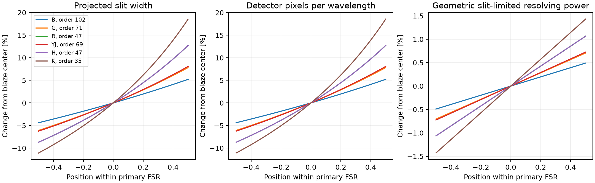
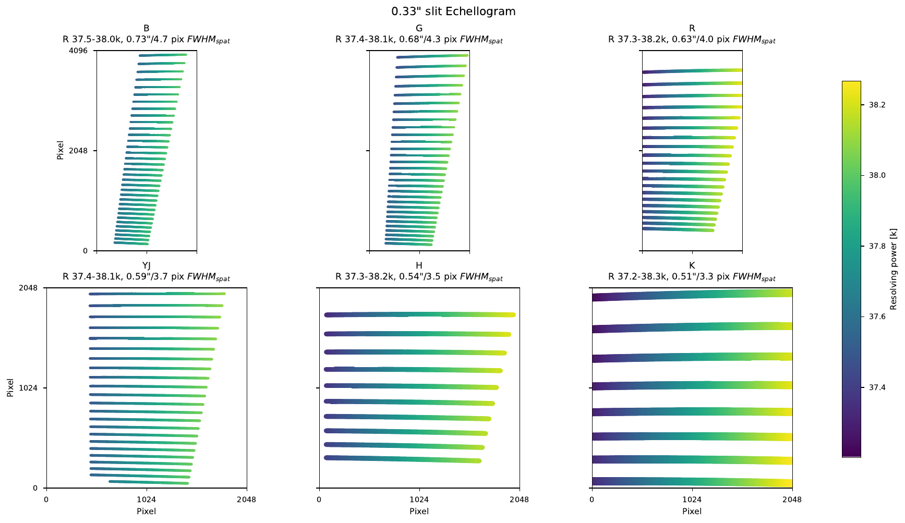
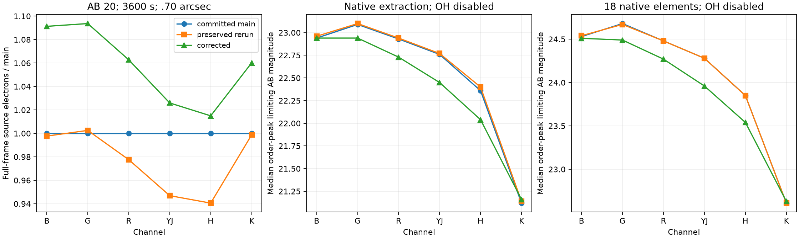
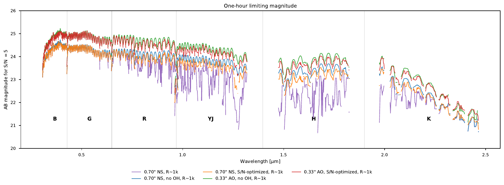
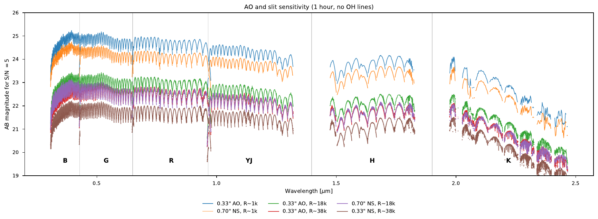

# ZShooter performance reconciliation

This compares three saved states: committed `main` (`6a616eab`), your rerun preserved before this repair, and the corrected execution on `xshooter`. Your notebook edits and original output directories are preserved. Corrected figures are written locally to `notebooks/zshooter_performance_corrected/`; the figures embedded here and the displayed numerical tables are committed under [reconciliation data](../validation/xshooter/data/reconciliation/). The performance notebook's source repairs are committed separately from your outstanding source edits and local executed outputs.

## Slit configuration and resolving power

There were two distinct configuration mistakes. The earlier upstream reset discarded a newly assigned .33 arcsec slit; your preserved current rerun already includes its repair. During this assessment I then selectively reran the .70 arcsec plotting cell while the train still held the preceding .33 arcsec configuration. That produced the approximately 38k plot labeled .70 arcsec. The .70 plotting cell now explicitly sets and prepares its own slit configuration, so it also works when rerun individually. The corrected .70 plot gives approximately 17.5–18.0k over its plotted detector coverage; .33 gives approximately 37.2–38.3k.

The smaller variation has a separate physical explanation. At fixed order, the configured planar grating obeys

\[
m\lambda=d(\sin\alpha+\sin\beta),\qquad
\frac{\partial\beta}{\partial\lambda}=\frac{m}{d\cos\beta},\qquad
\left.\frac{\partial\beta}{\partial\alpha}\right|_\lambda=-\frac{\cos\alpha}{\cos\beta}.
\]

Thus both the slit image and the detector dispersion contain the same angle-dependent factor. Their ratio gives

\[
\Delta\lambda_{\rm slit}=\frac{d\cos\alpha}{m}\frac{s_{\rm entrance}w}{f_1}.
\]

Here `s_entrance`, `w` and `f1` come from the configured entrance slit, active slit width and first collimator. The second collimator and camera enter the detector projection. Applying their pupil ratio again to the slit illumination angle would count it twice.

The [independent finite-angle calculation](../validation/xshooter/slit_anamorphism.py) propagates both entrance-slit edges through the grating and camera, rather than calling the slit derivative for its reference. It agrees with the derivative calculation within 0.00002%. Projected width changes substantially across an order; so does pixels per wavelength. Geometric resolving power varies by approximately one inverse order number across a primary FSR, about 1–3% for these orders. The old constant 4.46-pixel slit assumption retained changing dispersion without its matching slit magnification and consequently produced the larger 16–21k and 33–45k ranges.

The figure uses the middle configured order in each channel and the full primary FSR, including any portion outside the detector. The echellogram itself shows covered primary FSRs. The [all-order table](../validation/xshooter/data/reconciliation/slit_anamorphism.csv) preserves those distinct domains. The slit-image relation also follows the [NAOJ grating derivation](https://www.naoj.org/staff/pyo/IRCS_and_Reduction/node11.html).

This result is for geometric slit-limited resolution in the adopted planar prescription. Camera aberrations, non-coplanar coupling and wavelength-dependent optical image quality could change a Zemax line width. An optical export is needed to quantify those additions. Pixel-sampled point-source widths are measured separately in the comparison notebook.

## Echellogram rendering and geometry

Matplotlib's automatic pixel snapping produced visible steps and apparent thickness changes along nearly horizontal colored segments. Disabling snapping retains the smooth configured trace coordinates during rasterization. Adjacent segments remain connected. The plot's line thickness is its existing display fraction of inter-order spacing; it is not the projected slit width.

The accepted geometry is retained: June 2026 rulings, orders and CX angles, R shifted left 150 pixels, H left 130 pixels, YJ up 50 pixels with the reddest order removed, and B/G/K unchanged. Main versus rerun geometry differences include the accepted YJ/H order changes. No geometry was retuned to make the rendering look smoother.

## Three-state numerical comparison

The following values preserve the performance notebook's convention: .70 arcsec natural seeing, one hour on source, OH emission disabled, and the median of the best limiting-magnitude sample in each order. They are **order-peak summaries**, not wavelength-averaged sensitivity. The final column sums 18 native elements, approximately R=990 in the corrected calculation; it is not the comparison notebook's Gaussian R=1000 product.

| Channel | Source electrons, main / rerun / corrected (millions) | Native limiting AB, main / rerun / corrected | 18-element limiting AB, main / rerun / corrected |
|---|---|---|---|
| B | 10.199 / 10.176 / 11.130 | 22.94 / 22.96 / 22.94 | 24.53 / 24.54 / 24.51 |
| G | 17.767 / 17.813 / 19.431 | 23.09 / 23.10 / 22.94 | 24.68 / 24.67 / 24.49 |
| R | 16.594 / 16.223 / 17.636 | 22.93 / 22.94 / 22.73 | 24.48 / 24.48 / 24.27 |
| YJ | 16.124 / 15.268 / 16.542 | 22.76 / 22.77 / 22.45 | 24.28 / 24.28 / 23.96 |
| H | 10.723 / 10.086 / 10.884 | 22.36 / 22.40 / 22.04 | 23.85 / 23.85 / 23.54 |
| K | 9.136 / 9.125 / 9.686 | 21.12 / 21.14 / 21.16 | 22.61 / 22.61 / 22.63 |

Source totals are from the full-background source-minus-sky frames; the limits use the no-OH frames. The two products have different sky contents. [Exported values](../validation/xshooter/data/reconciliation/three_state_summary.csv) and [the extraction script](../validation/xshooter/reconcile_performance.py) make that distinction inspectable.

The higher source counts do not imply deeper limits: the corrected projection also changes sky counts per detector/extraction pixel. At each execution's brightest source pixel, the saved no-OH diagnostics give:

| Channel / state | Source electrons | Sky electrons | Subtracted variance (electron squared) | S/N |
|---|---:|---:|---:|---:|
| B / main | 102.556 | 6.811 | 117.413 | 9.465 |
| B / rerun | 101.472 | 7.150 | 117.008 | 9.381 |
| B / corrected | 111.992 | 12.510 | 138.247 | 9.525 |
| H / main | 184.715 | 81.962 | 350.360 | 9.868 |
| H / rerun | 182.817 | 76.053 | 336.643 | 9.964 |
| H / corrected | 203.944 | 174.861 | 555.386 | 8.654 |

These values describe the notebook's recorded peak pixels; their [coordinates](../validation/xshooter/data/reconciliation/corrected_peak_pixel_noise.csv) differ between runs. The sky entries were reconstructed algebraically from the printed `variance = source + 2*(sky + dark + read_variance)`, not measured independently from the underlying sky frame. The stated dark/read terms are the notebook assumptions for two 1800-second integrations: VIS dark = `3600*.000166 = .5976` electrons and read variance = `2*.1**2 = .0200` electron squared; NIR dark = `3600*.0001 = .3600` and read variance = `2*.5**2 = .5000`. They remain unchanged because those inputs remained unchanged, not because this comparison demonstrated that ScopeSim's detector treatment was unaffected. Within this recorded calculation, the larger inferred H sky term accounts for the lower S/N; this table alone cannot establish the physical cause or validate the sky projection. The separate direct frame/noise and grid-convergence checks support those claims. It is a historical explanation of the printed results, not a controlled sensitivity measurement at fixed wavelength and detector position.

The selected spatial boxcars also change. Main used B 7, G 6–8, R 5–7, YJ 5–7, H 5 and K 4 pixels; corrected uses B 6–8, G 5–7, R 5–7, YJ 5, H 4 and K 4. These widths are selected from the actual source/sky variance. Exact slit edges, PSF integration, physical-coordinate/Jacobian integration and finite spectral bins alter those inputs. The fixed epoch and accepted geometry/order changes are additional differences from main; these snapshots alone do not isolate a numerical percentage for each cause. The independent convergence and integral tests supply the evidence for using the corrected calculation.

For current forecasts, use the corrected outputs: the no-OH native limits are lower than the preserved rerun by .16–.36 mag in G/R/YJ/H, effectively unchanged in B, and .02 mag deeper in K. The older plots remain historical evidence. Their larger geometric-R variation and AO-background mismatch should not be interpreted as instrument performance.

## Comparison conventions

The corrected comparison uses a flat AB continuum, the same evaluated atmosphere for both instruments, seeing .65 arcsec, airmass 1.1, dark sky and a fixed epoch. Its throughput plots exclude atmospheric absorption. Extracted source fraction is an integral over each covered primary FSR; dividing a dispersed spectrum pixel by an undisplaced telluric curve gives artificial spikes near absorption lines and is not used as an aperture fraction.

Sensitivity uses an independent equal-time sky exposure. Its variance is source shot noise plus twice the sky, dark and read variance. This convention requires twice the on-source integration before observing overheads and differs from a background-known-exactly forecast. Covariance from spectral smoothing and rebinning is retained when measuring a resolution element.

The first stochastic comparison also exposed an experiment error: the automatic second source readout and the explicitly numbered sky readout both used readout ID 1, reproducing their read noise. The corrected experiment assigns source ID 0 and independent sky ID 1, and checks residuals separately for every arm. This changes the noisy validation realization, not the analytically propagated sensitivity.

The performance notebook also reused a natural-seeing background in its AO extraction. AO changes the finite integration grid. On the isolated middle K order, the no-OH background changed from 14,233.862 to 14,231.271 e/s: only 0.0182%, but already 0.82% of the AO source signal. The mismatch is amplified in faint spatial/spectral regions; the full notebook's K-band source-consistency check failed at 55 retained intervals. Each AO source now uses its own matched background, and the five-minute case reuses those matched rates. In the [controlled K-order experiment](../validation/xshooter/data/reconciliation/reused_background.csv), matched extracted source totals agree with and without OH emission, and fresh versus reused FOVs agree to numerical precision. This correction affects the old AO sensitivity estimates, especially near the red/edge regions of K; it is not a detector-QE effect.

The corrected full execution passes the source-consistency check at all 1,868 retained intervals. These are its updated versions of the two performance plots discussed in the review:

The [precision and cache audit](xshooter-validation.md) also removed single-precision accumulation from the exercised simulation path. This includes the inherited image-plane accumulator as well as the newly optimized spectral projection. The fresh-process full-frame AO observation takes 121.5 seconds, with setup and readout measured separately.

The performance notebook deliberately disables `shot_noise` and `readout_noise_selector` while obtaining expected-rate frames. Its variance calculation still includes source/sky shot noise, dark-current shot noise and read noise. This is an analytic sensitivity forecast, not a noisy realization. The comparison notebook separately enables stochastic detector effects and checks independent source/sky realizations against that variance calculation.

The [comparison results](xshooter-comparison-results.md) provide the executed resolution matching, detector alternatives, noise budgets and cadence checks. The [validation assessment](xshooter-validation.md) links the shared numerical tests and historical grid experiments.
