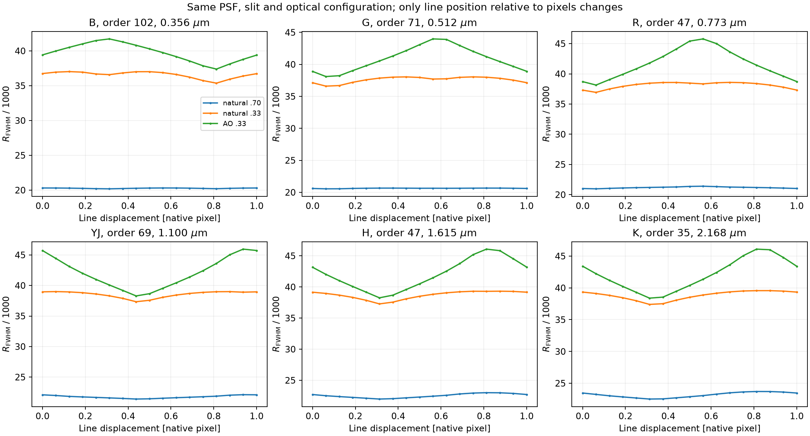
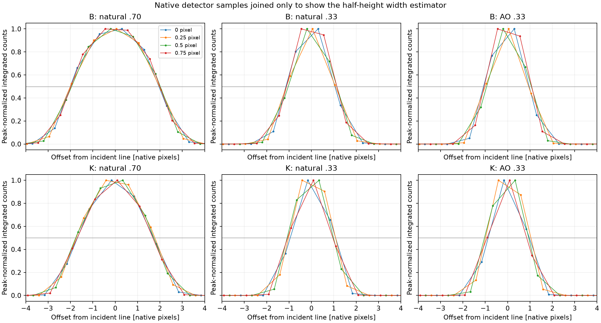
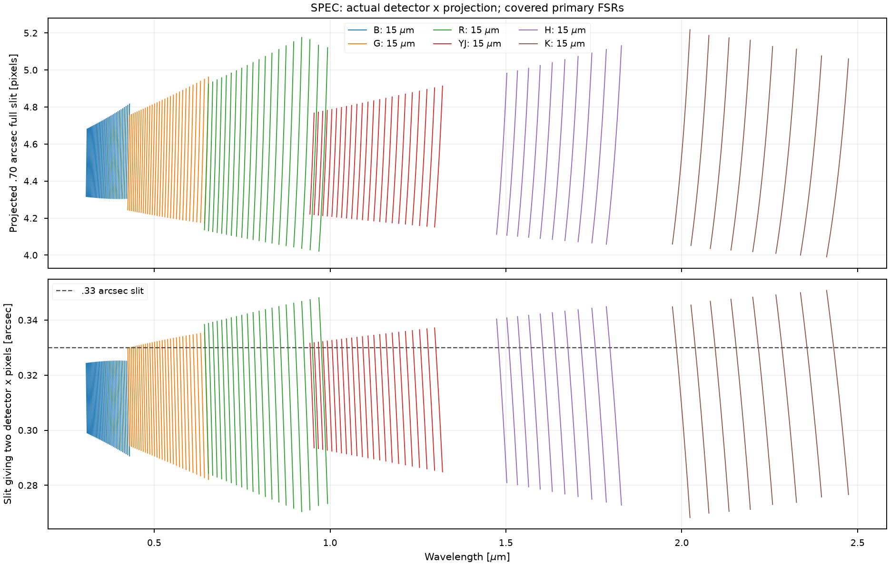

# ZShooter resolution: slit geometry, illumination and detector sampling

Internal working note for interpreting the current simulator and discussing slit/PSF design with the optical engineer. The approximately 18,000 geometric slit specification and a measured point-source FWHM resolving power of 20,000–24,000 describe different widths. The AO scatter also contains a substantial detector-phase effect in the present half-height measurement. Neither observation, by itself, establishes extra optical resolving power in the proposed instrument.

The calculations below use the configured June 2026 prescription, existing fixed placements, 15 micrometre pixels, and the existing natural/AO PSF prescriptions. No optical parameters or science figures were retuned. The [reproducible experiment](../validation/xshooter/resolution_sampling.py) uses the actual ScopeSim PSF, slit, spectral trace and native detector WCS.

## Which width is being measured?

| Quantity | Meaning in this discussion |
|---|---|
| Geometric full-slit width | Separation of rays from the two entrance-slit edges at one incident wavelength. It specifies a wavelength interval even before choosing source illumination. |
| Point-source LSF | Transmitted two-dimensional source illumination mapped across wavelength, integrated over the extraction aperture, with any subsequent optical blur and pixel response. |
| FWHM | Separation of the half-maximum crossings of that profile. The comparison currently interpolates crossings between native pixel counts. |
| EE80 width | A width enclosing 80% of an integral. A circular two-dimensional encircled-energy diameter and a one-dimensional LSF energy interval are different quantities. |
| Diffraction-limited resolving power | The wave-optical limit from the illuminated grating/pupil, commonly expressed as order times illuminated groove count for an ideal grating. This is not the slit-image width. |

Changing LSF shape changes the relation between FWHM, separation of two resolvable lines, and centroid precision. Thus even identical measured FWHM is not a complete statement of equal spectral information. [Robertson (2013)](https://arxiv.org/abs/1308.0871) develops that distinction explicitly.

## Why anamorphism does not give the expected 10% variation in geometric R

For the configured planar echelle, hold order and incident angle fixed:

\[
m\lambda=d(\sin\alpha+\sin\beta),\qquad
\frac{\partial\beta}{\partial\lambda}=\frac{m}{d\cos\beta}.
\]

An across-slit displacement changes the incidence angle. At fixed incident wavelength,

\[
\frac{\partial\beta}{\partial\alpha}=-\frac{\cos\alpha}{\cos\beta},\qquad
\Delta\alpha=\frac{s_{\rm entrance}w}{f_1}.
\]

Write the camera projection locally as \(x(\beta)\). Both the projected slit width and linear dispersion contain the same factors \(\partial x/\partial\beta\) and \(1/\cos\beta\). Their ratio is

\[
\Delta\lambda_{\rm slit}
=\frac{\Delta x_{\rm slit}}{|\partial x/\partial\lambda|}
=\frac{d\cos\alpha}{m}\frac{s_{\rm entrance}w}{f_1}.
\]

Consequently the slit image **does change its pixel width with anamorphism**. Holding that width at 4.46 pixels while allowing dispersion to vary keeps only one side of the ratio. The [NAOJ grating-magnification derivation](https://www.naoj.org/staff/pyo/IRCS_and_Reduction/node11.html) gives the same dependence of slit-image width on the incidence and diffraction angles.

The configured 1500/1250 mm collimators, 225 mm camera and 0.5306 mm/arcsec entrance scale give the reference width

\[
0.70\times0.5306\times\frac{225}{1250}\div0.015
=4.457\,\mathrm{pixels}.
\]

That is the reference magnification, not a constant at every wavelength. The effective dispersion focal length is \(225(1500/1250)=270\) mm; inserting the collimator ratio again into \(\Delta\alpha\) would double-count it. Across one primary FSR, approximately \(\lambda/m\), geometric \(R=\lambda/\Delta\lambda_{\rm slit}\) varies by approximately \(1/m\), about 1–3% here. The existing [finite-angle check](../validation/xshooter/slit_anamorphism.py) independently propagates the slit edges and confirms this calculation.

This is a conclusion about the adopted separable planar prescription. It is not evidence that Jason's description of the Zemax model is wrong. A useful comparison with him is a common table of full-slit width, point-source FWHM, dispersion, wavelength, order/FSR position and illumination, including the actual camera spot or LSF. A statement of “18k” without the width convention cannot resolve the disagreement.

## EE80 does not specify a 4.5-pixel FWHM

For a circular Moffat \(I(r)\propto[1+(r/a)^2]^{-\beta}\), the radial FWHM diameter and EE80 diameter are

\[
D_{\rm FWHM}=2a\sqrt{2^{1/\beta}-1},\qquad
D_{80}=2a\sqrt{0.2^{1/(1-\beta)}-1}.
\]

The configured natural-seeing \(\beta=4.765\) gives \(D_{80}/D_{\rm FWHM}=1.846\). A **0.70 arcsec EE80 diameter** would therefore mean a radial FWHM near 0.379 arcsec, not 0.70 arcsec. If EE80 instead denotes a radius, the interpretation changes again.

Integrating the untruncated Moffat along the slit gives a marginal profile proportional to \([1+(\eta/a)^2]^{1/2-\beta}\). Its FWHM is 1.062 times the radial FWHM for the natural PSF, and 1.098 times for the configured AO \(\beta=3.25\). The finite slit truncates this marginal; a finite extraction aperture changes it further. Then detector integration changes the profile and its measured half-height crossings. These operations cannot be replaced by identifying EE80, slit width and FWHM with one another.

The comparison's `seeing=.65` specifies the natural **radial FWHM at 500 nm before the airmass scaling**. It does not specify an EE80 diameter matched to the slit. At airmass 1.1 the configured FWHM is approximately .737 arcsec at .356 micrometres and .513 arcsec at 2.168 micrometres. This wavelength-dependent illumination is an important part of the rising natural/.70 point-source R.

## The rising natural R and the AO scatter, tested separately

The new experiment projects a narrow Gaussian line through the actual configured PSF/slit/trace. For each channel it holds the slit, PSF and order fixed and moves the line by one native pixel in 17 steps. It sums the complete spatial cutout, so aperture-selection changes are absent. The input line has \(R_{\rm FWHM}=200{,}000\), as in the comparison notebook; it is finite and much narrower than the output. Atmosphere, throughput and background are omitted because this experiment measures shape.

| Representative order | Wavelength [micrometres] | Natural/.70 measured R range | AO/.33 measured R range |
|---|---:|---:|---:|
| B 102 | .356 | 20,186–20,310 | 37,388–41,719 |
| G 71 | .512 | 20,545–20,660 | 38,099–43,981 |
| R 47 | .773 | 20,964–21,398 | 38,143–45,781 |
| YJ 69 | 1.100 | 21,407–22,120 | 38,291–45,951 |
| H 47 | 1.615 | 21,986–23,010 | 38,253–46,077 |
| K 35 | 2.168 | 22,515–23,702 | 38,385–46,091 |

The natural/.70 trend survives with the same order-center selection and fixed extraction. The redder, narrower seeing profile changes the slit illumination; pixel integration and half-height interpolation also matter, including where the continuous clipped profile has its half-height at the slit edge. It is not a wavelength-dependent improvement in the geometric full-slit specification. The comparison's broader 19,855–24,205 range additionally samples other orders and 20/50/80% FSR positions.

The AO prescription is an absolute Moffat FWHM table, roughly .394 arcsec at the representative B wavelength and .301 arcsec in K, with \(\beta=3.25\). It is not an Airy core plus seeing halo. In several channels the marginal FWHM before clipping is close to the .33 arcsec slit. Its sharp clipping edges and nonuniform illumination produce a narrow detector profile whose interpolated half-height depends strongly on phase. In K, the same optical configuration measures **1.73–2.08 pixels FWHM**, giving the 38.4–46.1k range above. It would be misleading to interpret that range as a real variation of the optical design's resolving power, or to explain all of it simply as a spot underfilling the slit.

The joined points show the actual width estimator: the maximum recorded pixel sets half-height, and adjacent samples determine each crossing. They are not a reconstructed continuous optical LSF. A later engineering comparison should fit or compare pixel-integrated line-profile models and report the phase dependence alongside the width. Merely smoothing this graph would hide the effect.

The 306 line projections plus 18 quadrature checks took approximately 25 seconds. Moving the line across a pixel changes integrated flux by at most .041%. Increasing detector integration quadrature from 4 to 16 changes flux by at most .24%, FWHM by .018%, and centroid by .00023 pixel. Those fixed-phase changes are much smaller than the phase-driven FWHM excursions. The existing [spatial/spectral convergence experiment](../validation/xshooter/line_convergence.py) separately checks those grid directions. These tests explain the scatter without attributing it to an unconverged detector integration.

## How narrow before detector sampling matters?

The following map projects the slit edges using the **actual rotated trace and native detector WCS**. It includes only center-ray locations on the detector within each primary FSR. It therefore differs slightly from unrotated internal echelle-coordinate widths. The lower panel is the slit width that projects to two detector-x pixels locally; the script substitutes this width back into the configured mapping and checks the result.

| Channel | .70 arcsec full-slit width [detector-x pixels] | Slit projecting to two pixels [arcsec] |
|---|---:|---:|
| B | 4.31–4.82 | .291–.325 |
| G | 4.17–4.96 | .282–.335 |
| R | 4.02–5.17 | .271–.348 |
| YJ | 4.15–4.91 | .285–.337 |
| H | 4.06–5.13 | .273–.345 |
| K | 3.99–5.22 | .268–.351 |

Thus .33 arcsec is already near two pixels, and its full-slit projection falls below two pixels in parts of some orders. A narrower illuminated spot can have still fewer pixels across its LSF even with a wider physical slit. The 4.46-pixel reference alone cannot set a safe lower slit width over the whole format.

**Two pixels per FWHM is an engineering sampling indicator, not a universal Nyquist limit.** Strict Nyquist concerns the highest spatial frequency transmitted by the optical/pixel transfer function. Slit edges, pupil diffraction and aberrations determine that function; profiles with the same FWHM can have different sampling requirements. [Robertson (2017)](https://arxiv.org/abs/1707.06455) demonstrates the dependence on LSF shape and phase and cautions against identifying two pixels/FWHM with Nyquist.

Intentional defocus is therefore a joint trade in slit transmission, continuous line shape, detector sampling and centroid precision. For each proposed slit and defocus, use the transmitted PSF and pixel-integrated LSF at several phases and FSR positions. Specify the acceptable flux loss and width/centroid variation rather than using the two-pixel map alone as a pass/fail boundary.

## Where diffraction enters this simulator

The current path applies an effective natural/AO PSF before the slit, then geometric slit-to-wavelength displacement and finite detector integration. It does **not** separately propagate the illuminated spectrograph pupil or convolve a post-slit diffraction/aberration LSF. Consequently it cannot establish the real instrument's ultimate resolution as the slit/spot is made arbitrarily small. In that regime the missing optical LSF becomes an essential input, not a reason to increase the numerical grid indefinitely.

The useful next optical-engineering input is a monochromatic detector PSF or line profile, including its pupil/illumination convention, at representative order centers and FSR edges. That permits a direct comparison of geometric slit width, continuous optical LSF and native detector samples, and an informed slit/defocus trade. It also gives a concrete way to determine whether the present 20–24k point-source predictions are realistic for the intended camera image quality.

Data: [all-order sampling](../validation/xshooter/data/resolution_sampling/slit_sampling.csv), [phase measurements](../validation/xshooter/data/resolution_sampling/pixel_phase.csv), [native profiles](../validation/xshooter/data/resolution_sampling/profiles.csv), [quadrature comparison](../validation/xshooter/data/resolution_sampling/quadrature_check.csv). Existing comparison plots retain their original values; this note clarifies their physical and measurement conventions.
