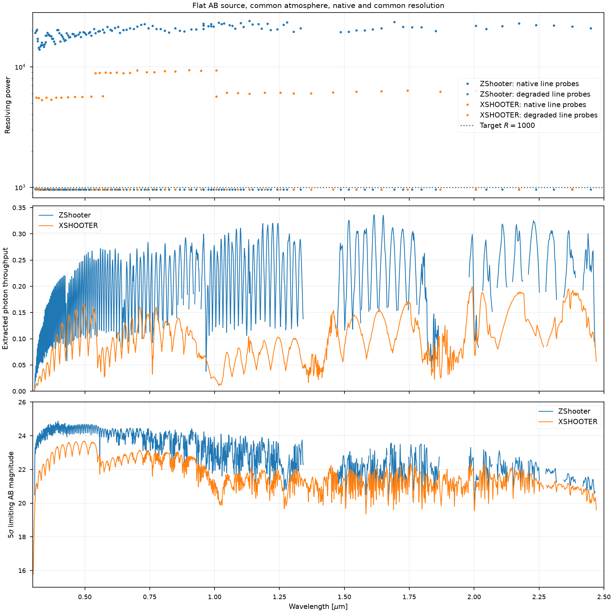
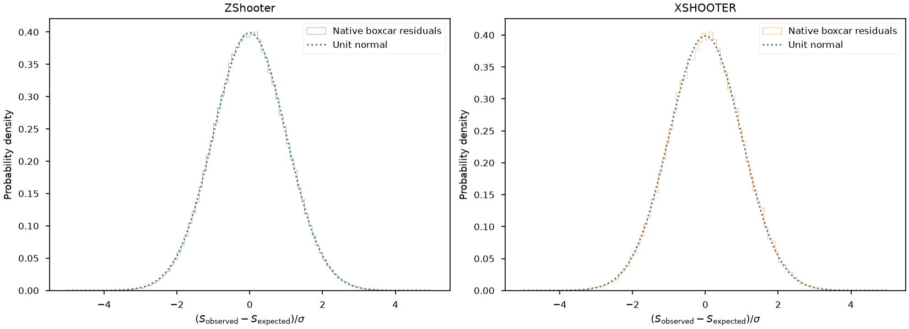
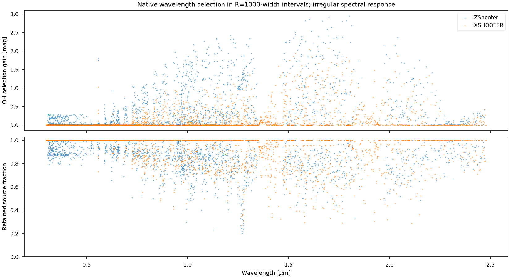

# Flat-AB instrument comparison

Executed 17 October 2026 with the adopted `xshooter` stack. Open [02_Flat_AB_Comparison.ipynb](../notebooks/02_Flat_AB_Comparison.ipynb) for the calculation and rendered outputs, or [the validation assessment](xshooter-validation.md) for shared-engine findings, tests, upstream integration and limitations.

The comparison now runs from full detector frames through native boxcar extraction to a common spectral width. The independent noisy-frame extraction agrees with the forecast variance. These are simulator forecasts under stated inputs, not an independent demonstration of either instrument's absolute on-sky sensitivity.

## Conditions and measurement

The source is a centered AB 20 flat continuum in frequency. Both instruments use the same evaluated atmospheric transmission, sky continuum and airglow spectrum, seeing 0.70 arcsec, airmass 1.3 and fixed epoch. The on-source integration is 300 s x 12 = one hour. An independent, equal-time sky measurement supplies the subtraction variance: source shot noise is counted once, background/dark/read variance twice. This corresponds to one hour on source plus an equal-time sky measurement; it is not a one-hour total observing-time budget. Observing overheads and sky-subtraction systematics are omitted.

ZShooter uses its configured six-channel design, 0.70 arcsec slits and current qCCD/APD specifications. X-shooter uses 1.0/0.9/0.9 arcsec slits, slow CCD readout, 1x2 spectral CCD charge binning and unbinned NIR. The higher-resolution preset and G5V/kilonova context recipes are provided but were not executed for this report. These manual-based settings are not claimed to reproduce the exact Pian et al. observing setup.

Spatial apertures are integer-pixel boxcars, chosen from expected signal and variance at nine points per order. The smallest width within 0.01 mag of the best expected limit is retained. Extraction uses the configured trace-to-detector coordinates and binning. It does not fit a spatial profile or require external calibration files. The notebook extracts 127 ZShooter and 43 X-shooter orders; partial detector-edge apertures are excluded.

Native isolated-line probes measure both FWHM and second moment. Gaussian degradation includes output-bin integration, and the calculation carries the full covariance of the smoothed samples. Four output samples make one nominal resolution element. Overlapping orders contribute the single best order at each element; no overlap-coaddition gain is assumed.

## Resolution, throughput and sensitivity

| Instrument | Native measured FWHM resolving power | Degraded measured FWHM resolving power |
|---|---:|---:|
| ZShooter | 13,888-23,985 | 959-964 |
| X-shooter | 5,313-9,392 | 959-963 |

The common second-moment width corresponds to R=1000 by construction. Sampling at four bins per nominal FWHM gives an interpolated FWHM measurement near R=960 for both instruments; the notebook reports this achieved value instead of relabeling it as exactly 1000. Each native probe samples one location per order. These measurements do not establish continuous wavelength-dependent optical fidelity. See [native measurements](../validation/xshooter/data/comparison/line_widths.csv) and [degraded measurements](../validation/xshooter/data/comparison/common_line_widths.csv).

The following are individual, matched wavelength elements, not filter averages. Blaze position, airglow and telluric structure produce substantial variation between adjacent elements. The nearest mutually covered element to 2.20 um is at 2.2090 um because of ZShooter's order coverage.

| Wavelength [um] | ZShooter 5-sigma AB limit | X-shooter 5-sigma AB limit | ZShooter extracted throughput | X-shooter extracted throughput |
|---:|---:|---:|---:|---:|
| 0.4500 | 24.62 | 22.93 | 0.216 | 0.077 |
| 0.5502 | 24.49 | 22.53 | 0.238 | 0.049 |
| 0.6502 | 23.74 | 22.80 | 0.132 | 0.120 |
| 0.8500 | 23.49 | 22.62 | 0.243 | 0.124 |
| 1.2505 | 22.25 | 21.40 | 0.214 | 0.102 |
| 1.6496 | 21.07 | 20.40 | 0.336 | 0.143 |
| 2.2090 | 22.50 | 21.83 | 0.223 | 0.136 |

Extracted throughput is detected source electrons divided by incident photons over the configured collecting area, time and wavelength interval. It includes the common atmosphere, instrument response, slit loss and finite boxcar aperture. The [full comparison table](../validation/xshooter/data/comparison/common_resolution.csv) retains signal and both variance components, so the reported magnitude can be inspected directly. Source Poisson noise scales with source amplitude when solving for the 5-sigma limit. Neighboring resolution elements remain correlated.

The forecast favors the present ZShooter design at these sample wavelengths. That result depends on its design throughput, detector specifications and thermal-background assumptions. In particular, its diffuse-emissivity option remains disabled as in the performance notebook, while X-shooter's empirical NIR background is enabled. The difference is visible in the configuration and has not been compensated by tuning the shared engine.

## Extraction from noisy frames

Source and sky frames use independent random streams. The extraction converts each native ADU convention back to accumulated electrons before subtraction: CCD sums and the X-shooter NIR average are handled separately. The same boxcar apertures are then applied to the noisy frames.

| Instrument | Native samples | Mean standardized residual | Standard deviation |
|---|---:|---:|---:|
| ZShooter | 259,284 | -0.0015 | 0.9981 |
| X-shooter | 79,269 | 0.0021 | 1.0011 |

Residuals are `(observed - expected) / predicted_sigma`. Their widths are consistent with the simulated shot/read/dark variance ledger. This checks extraction and counting conventions against independent noise realizations; it does not test detector systematics absent from the model. The [summary table](../validation/xshooter/data/comparison/noisy_extraction.csv), [aperture table](../validation/xshooter/data/comparison/apertures.csv), native FITS frames and in-kernel extracted spectra make the calculation inspectable. FITS frames and per-order sparse covariance matrices are generated locally and excluded from Git because they are reproducible, larger products.

The [native frame illustration](../validation/xshooter/data/comparison/native_frames.png) shows expected source electrons, with an independent arcsinh display scale for each detector. It illustrates geometry and coverage, not relative brightness across panels.

## OH selection and next uses

The OH diagnostic uses native samples within nominal R=1000-width intervals and selects wavelengths by expected source/background variance. It reports both the sensitivity gain and retained source fraction in [its own table](../validation/xshooter/data/comparison/oh_selection.csv). This creates an irregular spectral response and is deliberately separate from the common Gaussian-width curves. A large gain at a bright airglow line is not a universal gain for a structured astrophysical spectrum.

The fresh comparison took 44.4 s for the ZShooter source-plus-sky observation and 102.2 s for X-shooter, plus 1.5/0.5 s for their readouts. Separate sky observations took 41.7/98.8 s; their readout time was not separately recorded (the saved timing rows use zero for that untimed field). The line probes took 8.5/10.7 s. The notebook therefore takes several minutes in total because it executes four full observations and both calibrations. Each individual simulation stays below two minutes on this workstation. The separate profiled native-sky benchmarks are 60.9/74.4 s; sky-model complexity differs between those benchmarks and this common-sky comparison. [Comparison timings](../validation/xshooter/data/comparison/timings.csv) and [profiled timings](../validation/xshooter/data/full_frame_timings.csv) retain that distinction.

The next empirical test should use a held-out X-shooter observation with known seeing, slit, binning, exposure and extraction convention. Compare source counts, background, line width and uncertainty separately, without refitting to that observation. A published reduction or ESO/PyReduce extraction can provide a later cross-check. G5V and kilonova runs can then add science context while retaining this flat-AB technical baseline.
