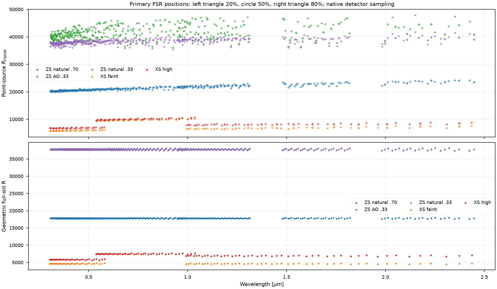
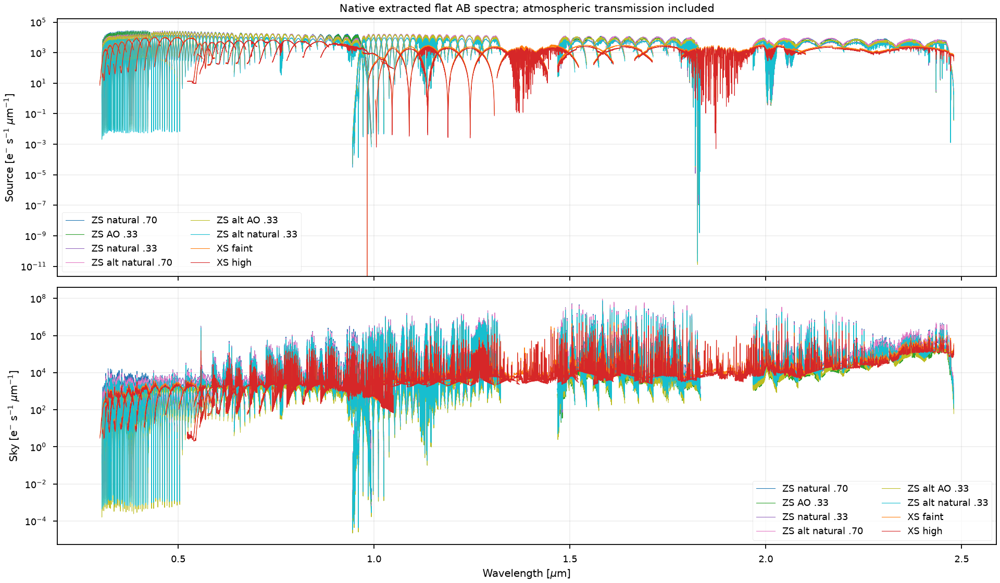
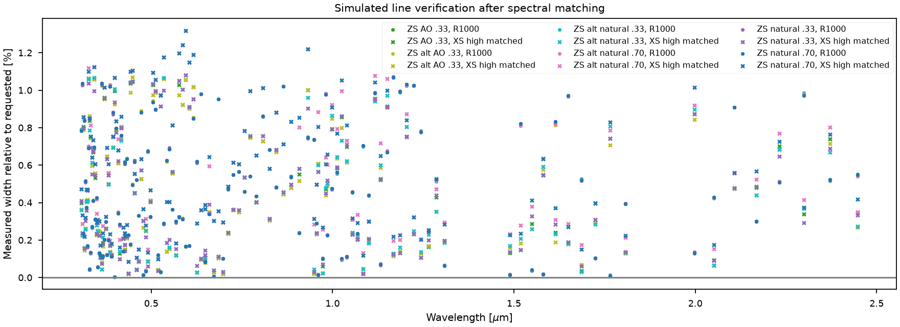
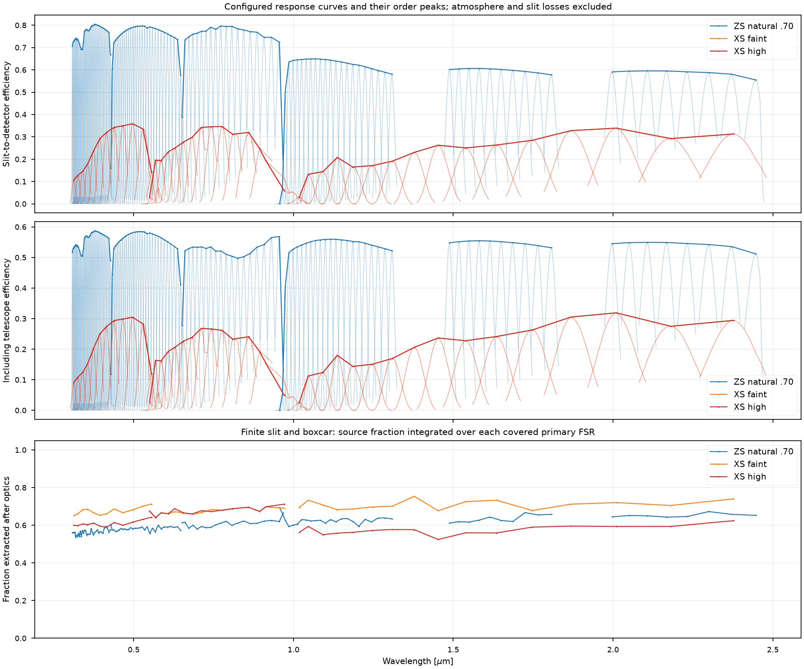
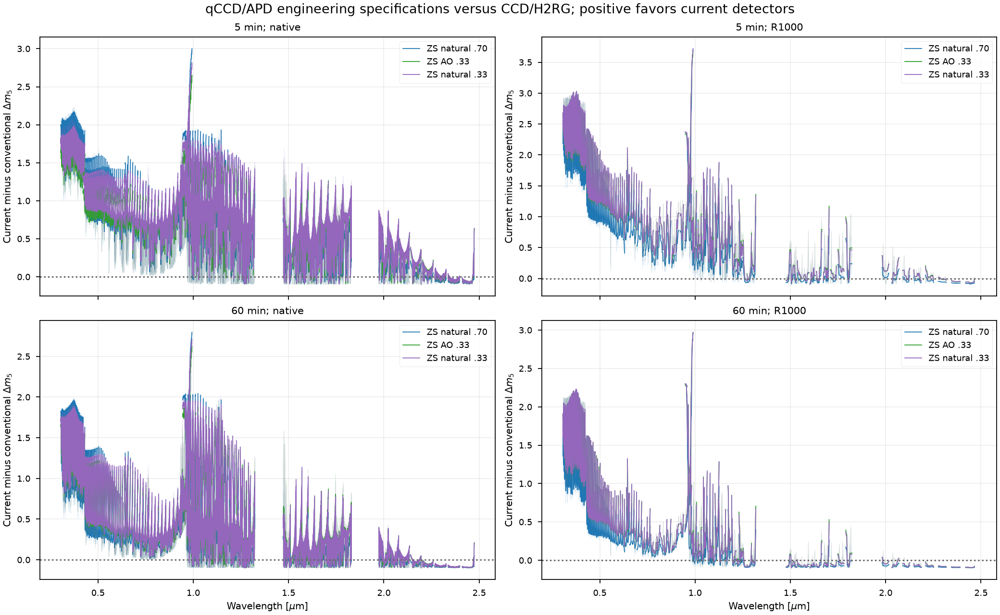
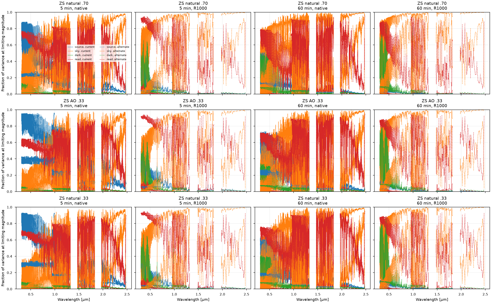
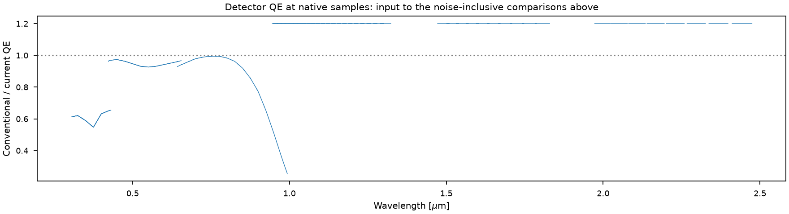
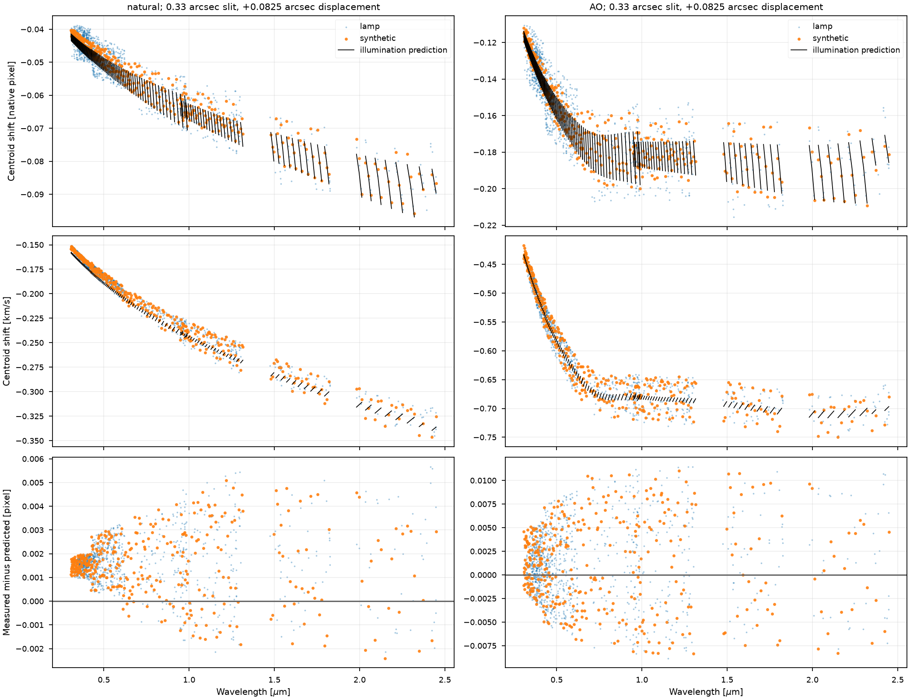
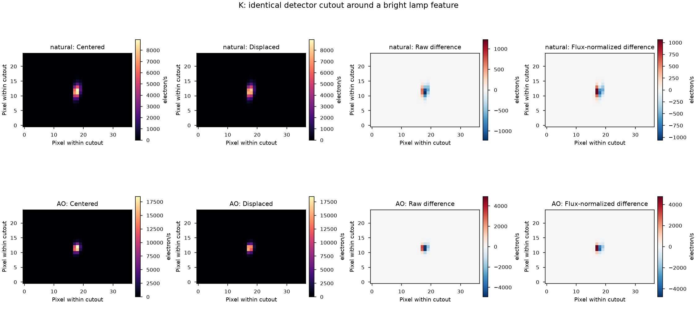

# Flat-AB instrument comparison

The executed [comparison notebook](../notebooks/02_Flat_AB_Comparison.ipynb) starts with a flat AB continuum and runs both X-shooter configurations, alongside ZShooter natural seeing with .70 and .33 arcsec slits and AO with .33 arcsec. This report supersedes the earlier single-mode comparison. The [performance reconciliation](performance-reconciliation.md) separately explains changes relative to main and your preserved performance-notebook rerun.

The subsequent [mirrored kilonova reduction assessment](kilonova-mirrored-reduction.md) covers native PyReduce extraction, propagated covariance and flat-AB controls in both kilonova notebooks. The [resolution teaching note](resolution-and-sampling.md) and [detector operating-point assessment](detector-operating-points.md) address the optical and detector questions raised while reviewing these plots.

The subsequent assessment also records the shared ADC correction: atmospheric displacement now precedes slit clipping in the Moffat/AO path used by these instruments. The plots on this page predate that correction. Their source and background rates need regeneration before being presented as results from the corrected simulator; the controlled ADC experiment is linked in the assessment.

All configurations share the same evaluated atmospheric curves: dark sky, airmass 1.1, seeing .65 arcsec and MJD 60310.25. AB 20 sets the simulation normalization; the limiting-magnitude calculation solves for the source amplitude giving S/N=5, including source shot noise.

## Observing settings and estimator

X-shooter faint-continuum mode uses 1.0/.9/.9 arcsec UVB/VIS/NIR slits, spectral CCD charge binning by two and unbinned NIR. Its higher-resolution mode uses .8/.9/.6 arcsec slits and unbinned detectors. Both modes are executed.

| Configuration | Five minutes on source | One hour on source |
|---|---|---|
| ZShooter, all detector alternatives | 300 s x 1 | 1800 s x 2 |
| X-shooter UVB/VIS, both modes | 300 s x 1 | 1800 s x 2 |
| X-shooter faint NIR | 300 s x 1 | 300 s x 12 |
| X-shooter high-resolution NIR | 300 s x 1 | 450 s x 8 |

The high-resolution NIR starting choice of 600 s reached approximately 89,871 electrons at the brightest source-plus-background pixel, just above the configured 89,000-electron linearity limit. The executed 450-second choice reaches approximately 67,404 electrons; faint-mode NIR reaches approximately 46,026 electrons at 300 seconds. These checks use the simulated line and thermal peaks, not a universal cadence rule. [Exposure/noise inputs](../validation/xshooter/data/comparison/exposures.csv) and [peak counts](../validation/xshooter/data/comparison/saturation.csv) are saved. The effective-noise table follows the [ESO NIR readout note](https://www.eso.org/sci/facilities/paranal/instruments/xshooter/doc/reportNDreadoutpublic.pdf).

ZShooter's 1800-second cases remain controlled engineering forecasts. Its H-band sky peaks reach roughly 0.4–0.6 million electrons per integration, above the disabled 64,000-electron linearity placeholder. A usable-well/reset specification is needed before adopting that NIR cadence operationally. This is a dynamic-range question, separate from effective read noise.

The estimator subtracts an independent equal-time sky exposure. Its variance is source shot noise plus twice the sky, dark and read variance. One hour on source therefore needs an additional hour of sky integration before overheads. NDIT is one within these independently combined exposures. X-shooter NIR internally averaged outputs are converted back to accumulated electrons for the variance check.

## Resolution and extraction

Isolated lines sample 20%, 50% and 80% of each primary FSR for both instruments. The figure separates measured point-source FWHM from geometric full-slit resolution. The latter is approximately 17,800/.70 arcsec and 37,800/.33 arcsec for the ZShooter analytic prescription. Its varying slit image and dispersion share the same anamorphic factor; [the independent grating check](performance-reconciliation.md#slit-configuration-and-resolving-power) explains why their ratio varies less than the old constant-pixel-width diagnostic.

Extraction uses integer-pixel boxcars selected from expected source and background variance. It chooses the smallest width within .01 mag of the best limit at nine positions per order. No profile fitting or optimal-extraction gain is assumed. The three ZShooter configurations each cover 125 traces; each X-shooter configuration covers 43.

The notebook shows native spectra, all configurations at approximately R=1000, and ZShooter degraded to the **measured** native width of high-resolution X-shooter. Gaussian redistribution is integrated over output bins, with eight samples per FWHM. Resolution-element variance uses the full smoothing/rebinning covariance. Overlapping orders contribute the best individual order; overlap-coaddition gain is not assumed.

The [matched-line measurements](../validation/xshooter/data/comparison/matched_line_widths.csv) verify achieved resolution against the target with a 2% acceptance limit. [Native measurements](../validation/xshooter/data/comparison/line_widths.csv) retain fractional FSR positions and distinguish point-source measurements from slit geometry. Pixel-phase effects remain visible for undersampled native profiles.

The executed point-source FWHM ranges are 19,855–24,205 for ZShooter natural/.70, 35,417–41,734 for natural/.33, 36,144–47,891 for AO/.33, 5,659–10,346 for X-shooter faint, and 6,612–10,633 for X-shooter high. These are ranges over all channels and the three FSR positions, not a single resolution assigned to an instrument. The maximum matched-resolution error is 1.33%.

## Throughput and sensitivity

Throughput excludes atmospheric absorption. Slit-to-detector efficiency and telescope-inclusive efficiency are evaluated from configured response curves at each order's peak. The extracted source fraction is a separate covered-FSR integral including slit and boxcar losses. Integrating that fraction avoids artificial telluric spikes from dividing a dispersed spectrum by an undisplaced transmission curve. [Order-peak values](../validation/xshooter/data/comparison/throughput_peaks.csv) are saved.

Sensitivity includes the common atmosphere and retains sky structure. Display-only median smoothing spans nine resolution elements; it does not change counts, covariance or measured resolution. The comparison uses independent-sky variance and measured point-source widths, so its curves should not be substituted directly for the performance notebook's fixed-native-bin plots. The reconciliation provides that bridge.

OH selection uses the same expected-signal/variance procedure for both instruments and reports retained source fraction. Its irregular wavelength weighting is shown separately from all-sample Gaussian-resolution sensitivity. These are different measurements for a structured source spectrum.

## Detector alternatives and noise checks

The detector trade covers five minutes and one hour, native and R approximately 1000, for natural/.70, AO/.33 and natural/.33. Conventional alternatives use 2.5-electron CCD and 6-electron effective H2RG read noise; current configurations use .1-electron qCCD and .5-electron APD values. These are engineering specifications. Optical rates are reused across detector/exposure forecasts.

The QE ratio is an input diagnostic. Magnitude differences and noise budgets show how read noise, sky and thermal backgrounds change its consequence with exposure, slit and final resolution. A QE advantage need not outweigh a read-noise penalty at native resolution; a sky-dominated bin can show little benefit from lower read noise.

An independent noisy extraction checks each arm separately. Source and sky have distinct realization IDs; the earlier accidental reuse of the same read-noise realization is corrected. [Standardized residuals](../validation/xshooter/data/comparison/noisy_extraction.csv) are checked against unit variance. Separate instrument tests cover CCD charge versus software binning and NIR summed/averaged conventions.

Across the 24 configuration/arm checks, standardized residual means range from -.0140 to +.0128, and standard deviations from .9942 to 1.0118. All pass the notebook's variance check.

## Slit-illumination lamp experiment

The executed [lamp notebook](../notebooks/03_Slit_Illumination_Lamps.ipynb) compares a centered source with a +.0825 arcsec across-slit displacement through a .33 arcsec slit. Both natural and AO effective PSFs are exercised. Full-frame pairs and identical feature cutouts show centered/displaced images, raw differences and differences normalized to equal integrated feature flux.

There are 1,089 usable calibration-lamp lines and 372 isolated synthetic probes per PSF. Lamp centroid shifts span -.095 to -.039 native pixel in natural seeing and -.215 to -.111 pixel with AO. The prediction integrates the transmitted illumination centroid through the same effective FOV PSF and configured across-slit dispersion. It does not assume that the source displacement equals the transmitted centroid displacement.

The largest measured-minus-predicted residuals are .0057 pixel for natural seeing and .0115 for AO; the isolated synthetic maxima are .0051 and .0110 pixel. These compare pixel-sampled measurements with a continuous-illumination prediction and include native pixel phase. They are distinct from the fixed-phase refinement errors, whose maximum centroid difference is .00203 pixel. The figure shows both residuals and physical shifts; blends are assessed against the synthetic probes. [Measurements](../validation/xshooter/data/lamps/centroid_shifts.csv) retain pixels and velocity units.

The [natural-seeing full-frame pair](../validation/xshooter/data/lamps/lamp_frames_natural.png) and [AO pair](../validation/xshooter/data/lamps/lamp_frames_AO.png) use a common intensity scale within each channel. These overviews display 8-by-8 pixel area means at native detector coordinates; the feature cutouts and centroid calculations use the original pixels. Individual lamp observations took 32–61 seconds; the slower AO background took 71 seconds.

## Interpretation and reproducibility

ZShooter retains the performance notebook's disabled diffuse post-disperser emissivity; X-shooter retains its empirical NIR background. Their thermal assumptions therefore contribute to the NIR comparison. They have not been tuned to make the instruments agree. The next independent fidelity test is a held-out X-shooter observation with known settings, comparing source counts, background, line width and uncertainty separately.

The [native-frame illustration](../validation/xshooter/data/comparison/native_frames.png), [apertures](../validation/xshooter/data/comparison/apertures.csv) and [timings](../validation/xshooter/data/comparison/timings.csv) accompany the notebook. Full frames and dense per-sample tables are regenerated locally and excluded from Git. The [validation assessment](xshooter-validation.md) gives convergence, precision, upstream checks and runtime. The [lamp notebook](../notebooks/03_Slit_Illumination_Lamps.ipynb) adds the centered/displaced engineering test. G5V and kilonova recipes remain secondary context; the executed technical baseline is flat AB.
