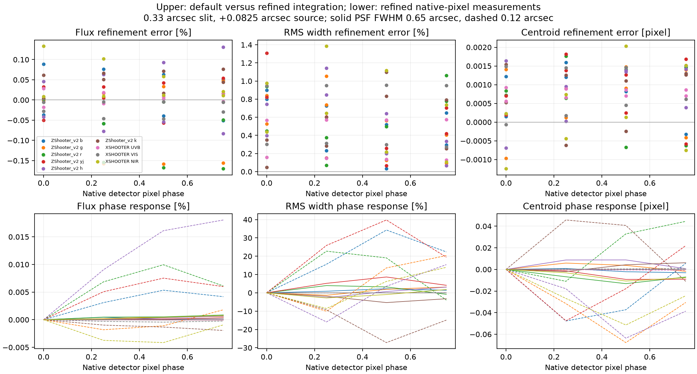

# X-shooter and shared simulator validation

Scientific evidence updated 18 October 2026; publication references updated for the Caltech review series on 23 October 2026.

Start with the [flat-AB comparison](../notebooks/02_Flat_AB_Comparison.ipynb), its [results report](xshooter-comparison-results.md), and the [performance reconciliation](performance-reconciliation.md). The [lamp experiment](../notebooks/03_Slit_Illumination_Lamps.ipynb) tests illumination-dependent wavelength shifts. [Instrument inputs](xshooter.md) give the X-shooter literature and calibration sources.

## Configuration and baseline corrections

Upstream's observation reset is preserved. Preparing a changed train uses the existing `update(migrate_cmds=True)` option; the immediate observation uses the existing `observe(update=False)` option. These are upstream interfaces, not new required public APIs. Parameters read during effect initialization require a reconstructed train. Independent observations clear image planes; exposure/noise forecasts reuse optical rate images.

The shared readout accepts global and per-arm exposure overrides through its actual interface, including explicit `!OBS.` keys. Arm defaults inherit global settings; explicit arm values take precedence. Tests exercise .70 → .33 → .70 arcsec and 3600 → 300 → 3600 seconds, reused versus fresh configurations, independent arms, detector geometry and FITS metadata.

The historical lost-.33-slit result came from the upstream reset discarding newly assigned settings. **Your preserved current rerun already has the correct .33 slit**: its old diagnostic reports approximately 33–45k. The reconciliation separates that rerun from committed main and the corrected calculation.

HAWKI's earlier header traceback was a failure, not an expected warning. Its missing default mode list is repaired. The [adoption notebook](../validation/xshooter/Upstream_Adoption.ipynb) now fails on logged readout errors and checks every populated science extension, INSTRUME, DIT, NDIT and EXPTIME.

The later saved traceback was MOSAIC's missing instrument identity, followed by exposure cards being lost during conversion to a spectral table. Both are now repaired, with count/header tests for all three output formats and an executed MOSAIC observation. The [runtime assessment](notebook-runtime-checks.md) records this separately from HAWKI's earlier fix.

That stricter run exposed a shared discrete-PSF cache error in MICADO spectroscopy: a kernel selected by reference-file layer was reused for a different FOV wavelength grid. Sampled kernels are now recomputed for each request, and wavelengths are converted using the header unit. The 3-to-5-plane and nm/um tests pass. That earlier run also exposed MOSAIC's missing primary `INSTRUME`: its telescope header effect suppressed the minimal-header writer without supplying instrument metadata. The later MOSAIC configuration and table-output repairs described above fix that failure; the nine-mode passing table below remains the historical result of the earlier run.

The final [passing-case table](../validation/xshooter/data/adopted_upstream_observations.csv) contains nine modes: MICADO SCAO/MCAO/SPEC, METIS imaging L/M and N, long-slit L and N, LMS, and HAWKI. These all have positive source flux, finite outputs and the required exposure/instrument metadata.

## Optical prescription and resolution

ZShooter retains the accepted June 2026 prescription and placements from the [geometry work](zshooter-xdisp-geometry.md): R left 150 pixels, H left 130 pixels, YJ up 50 pixels with order 57 removed; B/G/K unchanged. This assessment does not retune those placements.

Section 4 of the instrument paper supplies the 1500/1250 mm collimators, 225 mm camera and 530.6 micrometre/arcsec entrance-slit scale. Their ratio gives the existing 270 mm effective dispersion focal length and 4.457-pixel .70-arcsec reference sampling. The across-slit wavelength derivative comes from the grating equation and first collimator. Projecting that wavelength interval through the actual trace gives a wavelength-dependent slit width in detector pixels.

This removes the assumption that a slit projects to the same 4.46 pixels everywhere. Geometric resolution is close to 17,800 at .70 arcsec and 37,800 at .33 arcsec, with the smaller wavelength variation expected from this analytical prescription. Simulation and diagnostic tables consume the same derivative. The asymmetric pupil ratio is applied once. The planar grating approximation remains intentional; non-coplanar coupling and camera distortion await an optical-model export.

The comparison measures point-source lines at 20%, 50% and 80% of each primary FSR for both instruments. Geometric full-slit resolution and pixel-sampled point-source FWHM appear separately. Detector coverage outside the primary FSR is not substituted for these positions. Pixel phase can visibly change the measured FWHM of an undersampled line even when numerical integration has converged.

## Shared numerical findings

* Physical aperture edges are tiled exactly. Continuous point positions are integrated through the effective Moffat PSF before clipping, admitting off-slit light without extra bilinear deposition broadening.
* Resolved images/cubes use their signed spatial WCS and pixel areas. Spectral bin integrals preserve native input knots, including narrow lamps and OH lines.
* Finite wavelength and across-slit cells are integrated through wavelength displacement. Detector pixels receive area integrals through the configured inverse trace and Jacobian. Geometry is recomputed; slit operators are keyed by their complete evaluated physical inputs. Quadrature resolves each detector axis separately.
* Cube-to-spectrum collapse now includes the pixel area of a prepared surface-brightness cube. Restored tests compare table, image, cube, two-cube and mixed inputs through separate 1D/2D/3D FOV classes at two spectral steps.
* Charge binning precedes read noise; software binning follows it. Exposure sums and internally averaged products retain their own scaling. Repeated readouts advance the random realization; an explicit readout ID reproduces it.
* Integer ADC shifts remain the deliberate fast approximation. Consecutive planes with the same displacement are shifted together, and light shifted wholly off a frame is clipped.

The old **0.54746** and **1.09501** flux ratios came from [this witness experiment](../validation/xshooter/run_report_witness.py); their original console values are in [report_witnesses.txt](../validation/xshooter/data/report_witnesses.txt). They describe old grid-dependent mappings, not uncertainties assigned to today's forecasts. The witness script and console record preserve the original experiment; the superseded assessment was removed from the working documentation.

[Finite-cell convergence measurements](../validation/xshooter/data/line_convergence.csv) cover all six ZShooter channels and all three X-shooter arms, two effective PSF widths, four detector phases and spatial/spectral refinement. [Within-pixel geometry checks](../validation/xshooter/data/pixel_linearization.csv) cover all 125 ZShooter and 43 X-shooter traces: the locally affine approximation differs from exact corner mapping by less than 0.00015 native pixel. The figure separates errors at fixed detector phase from actual changes caused by moving an undersampled line across a pixel.

With double-precision arithmetic, the largest measured refinement differences are **0.171% integrated flux, 1.385% line width and 0.00203 native pixel centroid**, inside the agreed 1%/2%/.01-pixel targets. A trial with 12 rather than 20 wavelength cells per effective slit/PSF width reached 3.33% width error and was rejected; [those trial errors](../validation/xshooter/data/line_convergence_12_cell_errors.csv) are retained. Production uses 20 cells.

The spectral cubes, slit-projection weights and accumulation, projected images, image-plane accumulation and extracted sums now use **float64**. The earlier centroid diagnostic mixed a float32 total-flux sum with a double-precision weighted wavelength sum. It now sums in double and measures wavelength offsets about the line center. An [isolated storage test](../validation/xshooter/storage_precision.py) found float32 cube-rounding differences below 5.6e-9 in flux and 4.5e-9 pixel in centroid for isolated lines, but that alone does not justify rounding a faint source combined with a bright background. Double precision is retained throughout this exercised path. Tests explicitly preserve a faint contribution beside a 1e8 background and retain input-cube contrast during unit conversion. After the cache audit below, the fresh-process six-channel AO/.33-arcsec benchmark took **121.5 s**, with 10.8 GiB peak process memory, 10.28 s setup, .88 s explicit update and 1.91 s readout. This replaces the earlier 102.6-second measurement made before that audit. The observation is 1.5 seconds above the approximate two-minute target. Small wavelength blocks bound the temporary point-source multiplication without lowering precision.

The PSF remains an effective, bounded wavelength-average model. Full wavelength-dependent sky+telescope+instrument convolution is outside this design. Its adequacy is tested against the intended slit and extraction calculations. ZShooter detector inputs are engineering specifications or design estimates. Effective APD/H2RG read noise is sufficient here; detailed ramp statistics and Pyxel are deferred.

## Cache validity and stochastic science frames

The cache audit found and removed three unsafe forms of reuse: detector geometry keyed without the mutable optical transforms, spectrum sampling keyed by object identity, and sampled PSF arrays exposed to caller mutation. The detector geometry and sampled kernels are now recomputed. Modifying a returned PSF no longer modifies its loaded reference image.

Source wavelength sampling is evaluated after source effects on the observation's private source copy. That local sampling is reused only while extracting its FOVs and is discarded at the end of `observe()`. Native-sampled spectra are copied during extraction before FOV effects operate on them. Direct FOV/extraction calls recompute sampling, and the next observation takes a new snapshot. This removes repeated sorting without retaining spectral state across observations. A trial that recomputed the full source sampling separately for every order exceeded six minutes and was stopped; the unsafe persistent cache was not reinstated.

The remaining slit-integration cache includes every wavelength, across-slit coordinate, slit-cell width and evaluated dispersion value. Input photon values are multiplied afresh on every call. PSF-table interpolators compare the resolved path and file bytes, including AO alpha where relevant; overwriting a table at the same path invalidates them. The small Gauss–Legendre cache depends only on quadrature order and exposes read-only arrays.

Regression tests change spectral redshift, source weights, slit widths, exposure settings, WCS origins/steps/PC terms/units, slice centers, callable dispersion values, optical-transform coefficients, PSF return arrays, AO settings and table contents. Reused results are compared with fresh calculations. The combined cache/noise suite passed 147 tests with one inherited expected failure. After moving source sampling into the observation, 18 targeted source/FOV/image-plane and reused-versus-fresh tests passed. These suites overlap the earlier runs.

Science observation examples, including both kilonova notebooks, retain enabled source/sky/dark shot noise and read noise. Conventional detectors draw Poisson photon/dark counts. ZShooter's configured LmAPDs draw compound Poisson/gamma photon counts with variance F times their physical mean, plus independent Poisson dark counts and effective read noise. F=1 recovers ordinary Poisson statistics. Fixed seeds make runs reproducible; distinct readout IDs and detector IDs produce independent realizations. The [detector operating points](detector-operating-points.md) define these engineering inputs and explicit per-arm exposure settings.

Both performance forecast notebooks temporarily disable random draws while calculating expected-rate sensitivity. Their helper restores the original flags on normal completion and on exceptions, now covered by regression tests. The lamp centroid experiment uses expected-rate images to isolate systematic shifts, explicitly labeled electron/s; those are numerical diagnostics. The comparison notebook additionally extracts actual noisy readouts. New tests exercise nine spatial regions with different source/sky rates, including dark-only, sky-only and source-only regions, through all six ZShooter and three X-shooter detector arms. Their pixel-dependent variances and independent repeated realizations pass.

## Comparison conventions

The baseline is a centered flat AB continuum, common evaluated atmospheric curves, dark sky, airmass 1.1, seeing .65 arcsec and MJD 60310.25. Instrumental-throughput plots exclude atmospheric absorption and distinguish slit-to-detector efficiency, telescope-inclusive efficiency and extracted source fraction. Sensitivity includes the common atmosphere.

Both X-shooter modes are executed: faint-continuum 1.0/.9/.9 arcsec with spectral CCD binning by two, and .8/.9/.6 arcsec with unbinned CCDs; NIR is unbinned. ZShooter covers natural seeing with .70 and .33 arcsec slits and AO with .33 arcsec. The notebook compares native spectra, common R approximately 1000, and ZShooter degraded to measured higher-resolution X-shooter widths.

Extraction remains an integer-pixel boxcar. Variance includes shared-pixel covariance after rebinning. OH selection is separate, with retained source fraction reported. Display smoothing never defines measured spectral resolution.

The estimator is source-plus-sky minus an independent equal-time sky frame. Source shot variance appears once; sky, dark and read variance appear twice. One hour on source therefore requires an additional hour of sky integration before overheads. The [results report](xshooter-comparison-results.md) gives cadences, NIR linearity checks, detector trades and measured line widths.

## Verification and reproducibility

The targeted shared optical/source/detector/instrument suite passed **184 tests**. The subsequent precision, discrete-PSF, image-plane, FOV and comparison tests passed **113 tests**, with three inherited expected failures; the source-preparation/spectral-integral suite passed **13 tests**. These runs overlap and are not additive. The 14 stale helper tests and two source-helper failures from the earlier report have been repaired and exercised; lamp normalization remains per input calibration file.

The initial detector-package update passed the full **186-test zs-scopesim suite** and **28 DRP tests**. The subsequent YJ H2RG change passes both targeted detector-mode tests, including all 125 physical trace mappings, and all six calibration-reuse checks. Those mode tests now compare effects and headers with the loaded IRDB settings instead of assuming fixed pitches, noise factors or wells for a mode name. Earlier checks cover avalanche photon variance, independent detector random draws, per-integration well warnings without changing exposure settings, and rejection of mismatched calibration geometry. The later runtime repair again passes all 186 workspace tests, plus 17 covariance tests and 25 MOSAIC tests. Both kilonova notebooks now extract all three epochs from the saved stochastic frames. The [operating-point assessment](detector-operating-points.md#reduction-and-verification) retains the continuum-control measurements and the still-invalid faint-mode X-shooter NIR flux calibration; that calibration requires repair before its science fluxes can be compared.

Useful skipped cross-representation tests have been replaced by current-subclass photon-integral tests. Two historical image tests have separate wavelength-grid/end-bin assumptions; their expected-failure labels remain. Relevant tests are not excluded merely for being slow.

[Performance.ipynb](../validation/xshooter/Performance.ipynb) and [timings](../validation/xshooter/data/full_frame_timings.csv) retain historical measurements. Setup, observation and readout are timed separately; the comparison records line-analysis costs too. Benchmarks exclude network acquisition. The current comparison executes eight configurations and independent sky frames, reusing optical rates for exposure changes within each package. Detector-package changes construct and observe a new train.

The preceding baseline benchmarks used fresh kernels, with double precision and the audited reuse described above:

| Configuration | Setup (s) | Explicit update (s) | Observation (s) | Readout (s) | Peak process memory (GiB) |
|---|---:|---:|---:|---:|---:|
| ZShooter AO, .33 arcsec | 10.28 | .88 | 121.51 | 1.91 | 10.83 |
| X-shooter faint, CCD spectral binning by two | 2.64 | .03 | 83.66 | .52 | 9.03 |

The initial detector-package notebook reruns executed concurrently with other notebook work. Their saved timings measure that contention and are not an isolated two-minute performance acceptance test. The alternative package is observed separately because its geometry and QE differ; exposure-duration forecasts reuse rates within that package. The later [performance-cell profile](detector-operating-points.md#performance-cell-runtime) identifies twelve optical renders and substantial table-construction overhead in the single comparison cell. This is distinct from the time for one full-frame observation.

The repositories retain upstream integration and the independently mergeable xdisp branch. Feature commits group configuration repairs, physical mapping, finite-cell integration, representation correction, extraction/covariance and executed evidence. The [stack manifest](../env/zshooter-stack.toml) pins the published Caltech ScopeSim, IRDB, DRP and PyReduce review branches by commit. The original feature branches remain available for historical comparison.

## Independent evidence

The independent optical-efficiency check agrees at about one percent, adequate for this comparison. The small ESO collecting-area convention difference is an upstream release consideration. X-shooter's calibrated trace/LSF inputs and empirical NIR background remain explicitly instrument-specific; matching those same fitted inputs is not counted as independent validation.

A held-out X-shooter observation with recorded slit, seeing, binning, DIT/NDIT and flux calibration would test counts, background, line width and uncertainty beyond the shared numerical tests. A comparable boxcar reduction is sufficient for that first check. An ESO or PyReduce extraction can follow when its calibration effort serves the science comparison.

Settings and detector limits come from the [ESO manual](https://www.eso.org/sci/facilities/paranal/instruments/xshooter/doc/VLT-MAN-ESO-14650-4942_P114v1.pdf) and [NIR readout note](https://www.eso.org/sci/facilities/paranal/instruments/xshooter/doc/reportNDreadoutpublic.pdf). [Pian et al. (2017)](https://arxiv.org/abs/1710.05858) supplies the kilonova context; flat AB remains the technical baseline.
