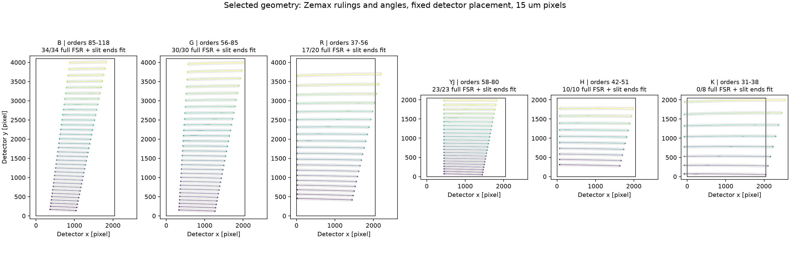
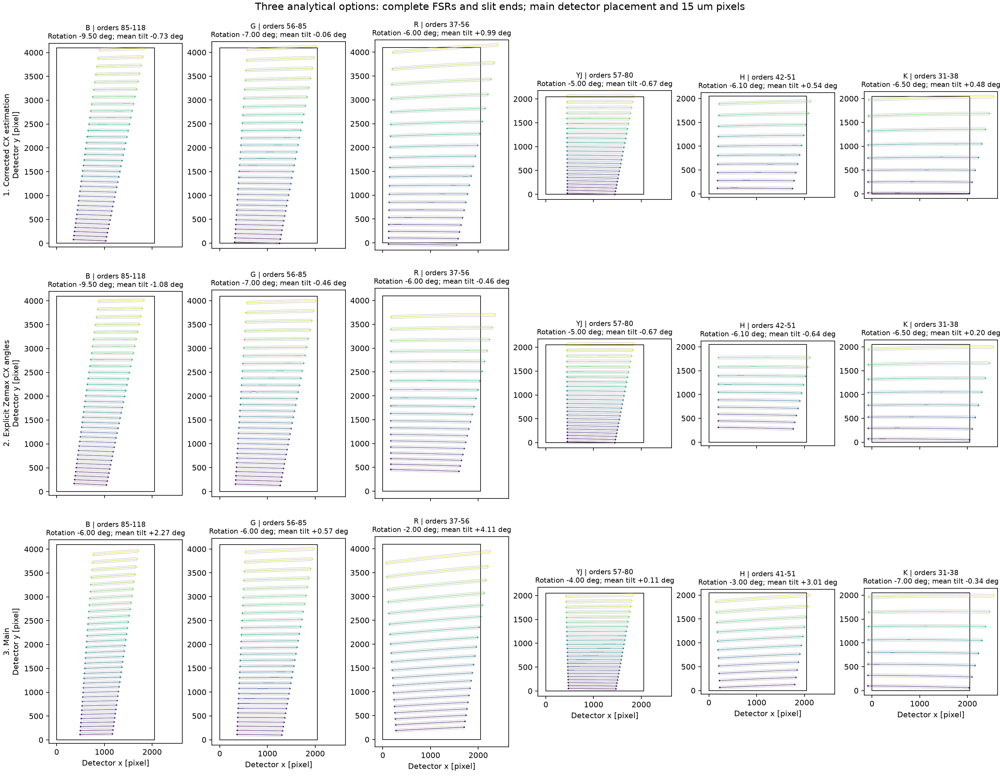

# ZShooter: selected analytical geometry

The geometry branch now uses **row 2's Zemax rulings, order prescription, CX angles and detector rotations**, with the fixed placement below. R moves left 150 pixels, H left 130 pixels, and YJ moves up 50 pixels with reddest order 57 removed. B, G and K keep row 2's positions.



Colored curves show complete FSRs at slit center; gray curves show both ends of the 10-arcsecond slit. Black rectangles are the detectors. Each panel has equal X/Y pixel scales; all panels share the X range. Off-detector portions remain visible.

| Channel | Retained orders | Shift from row 2 (pixels) | Complete FSRs including both slit ends on detector |
|---|---|---|---:|
| B | 85-118 | None | 34/34 |
| G | 56-85 | None | 30/30 |
| R | 37-56 | 150 left | 17/20 |
| YJ | 58-80 | 50 up | 23/23 |
| H | 42-51 | 130 left | 10/10 |
| K | 31-38 | None | 0/8 |

**YJ's shift brings the bluest order onto the detector.** Order 80's full FSR/slit envelope clears the bottom by **17.40 pixels**. Removing order 57 makes room at the red end: order 58 clears the top by **25.64 pixels**. The retained orders span Y = 17.40-2022.36 on the 2048-pixel detector. Removing order 57 does not trigger recentering.

H spans X = 63.83-1990.15 pixels. R retains partially clipped orders 37-39; orders 40-56 fit completely. K's clipping is unchanged from row 2, as accepted pending discussion with the optical engineer. Its eight orders still intersect the detector, although none has its entire FSR and slit envelope inside it.

The actual model bounds are in [selected_orders.csv](../validation/zshooter_xdisp/data/selected_orders.csv) and [selected_footprints.csv](../validation/zshooter_xdisp/data/selected_footprints.csv).

## Fixed placement in the parameter file

The new `detector_offset_x` and `detector_offset_y` columns specify the **rotated analytical camera origin relative to detector center**, in mm, positive right/up. They are absolute positions; `(0, 0)` places that origin at detector center. They replace automatic centering and are applied after rotation, before detector clipping.

| Channel | `detector_offset_x` (mm) | `detector_offset_y` (mm) |
|---|---:|---:|
| B | -0.679871 | -3.156243 |
| G | -0.569446 | -4.041061 |
| R | -2.867205 | -5.372810 |
| YJ | -0.441923 | -3.921145 |
| H | -2.474361 | -4.610933 |
| K | -0.621554 | -5.307695 |

These values were derived once from row 2's configured mapping, with the requested translations added at 0.015 mm/pixel. YJ's position was fixed before excluding order 57. The `.dat` file documents that temporary exclusion and retains `m0=80, n=23`. The simulator reads these constants directly; it does no placement search. Both columns require their corresponding `*_unit : mm` declarations. Omitting both preserves main's original automatic placement and wavelength sampling.

## Three-option decision reference

The original comparison below is unchanged. Its three rows show:

| Row | Rulings and order numbers | CX angles | Detector rotations |
|---|---|---|---|
| **1. Corrected CX estimation** | Zemax | Corrected angle-estimation equation | Zemax |
| **2. Explicit Zemax CX angles** | Zemax | Explicit Zemax angles in the existing analytical model | Zemax |
| **3. Main** | Main | Main's original angle-estimation equation | Main |



Colored curves show every order's complete FSR at slit center; gray curves show both ends of the 10-arcsecond slit. Black rectangles are the configured detectors. All three rows use the same wavelength colors and axis limits within each channel, equal X/Y pixel scales, and a common X range. Traces continue through their full FSRs, including portions outside the detector. Mean tilt weights orders equally.

**Main's detector-placement calculation is used in all three rows.** The later full-FSR recentering change is excluded. Camera/effective dispersion focal lengths remain 225/270 mm; pixels remain 15 micrometers; detectors remain 2048 x 4096 in VIS and 2048 x 2048 in NIR. Each case also retains main's FSR endpoint convention.

## Inputs actually used

The archive is `20260610B_ZS_6CH_Complete_Spectrograph.zar`. Options 1 and 2 share the following rulings, orders and rotations:

| Channel | Orders, options 1/2 | Echelle grooves/mm, options 1/2 | CX grooves/mm, options 1/2 | Detector rotation, options 1/2 (deg) | Detector rotation, main (deg) |
|---|---:|---:|---:|---:|---:|
| B | 85-118 | 50.15 | 2000 | -9.50 | -6.00 |
| G | 56-85 | 50.15 | 1100 | -7.00 | -6.00 |
| R | 37-56 | 50.15 | 625 | -6.00 | -2.00 |
| YJ | 57-80 | 24 | 350 | -5.00 | -4.00 |
| H | 42-51 | 24 | 300 | -6.10 | -3.00 |
| K | 31-38 | 24 | 270 | -6.50 | -7.00 |

Main differs in three additional entries: its VIS echelle ruling is **50.00/mm**, its YJ CX ruling is **325/mm**, and its H orders are **41-51**. The other rulings and order limits match the table.

The actual CX incidence / camera-reference angles, in degrees, are:

| Channel | Option 1: corrected estimation | Option 2: explicit Zemax | Option 3: main |
|---|---:|---:|---:|
| B | 16.41 / 27.49 | 21.20 / 21.20 | 24.74 / 18.91 |
| G | 8.68 / 26.56 | 16.75 / 16.75 | 16.51 / 18.20 |
| R | -7.58 / 40.33 | 14.10 / 14.10 | 1.85 / 28.72 |
| YJ | 10.78 / 12.48 | 10.90 / 10.90 | 4.15 / 17.58 |
| H | -6.49 / 37.55 | 13.70 / 13.70 | 2.45 / 26.94 |
| K | 10.93 / 24.25 | 16.80 / 16.80 | 17.85 / 17.06 |

Option 2 uses the existing explicit-angle convention: the supplied angle sets both CX incidence and camera-reference angle. Its value is `-sign(camera_space) * CX_tilt` from the archive. Detector point rotations in options 1/2 are the negatives of the archive's detector-coordinate rotations. These are the conversions used for this analytical comparison.

Full-precision values are in [settings.csv](../validation/zshooter_xdisp/data/settings.csv); [orders.csv](../validation/zshooter_xdisp/data/orders.csv) contains the full-FSR/slit bounds, and [footprints.csv](../validation/zshooter_xdisp/data/footprints.csv) contains channel summaries. The [archive extraction](../validation/zshooter_xdisp/data/zemax_channels.csv) retains its original coordinate angles.

## Reproduce and verify

The selected configuration was verified with ScopeSim commit `4c64fe55` and IRDB commit `2e9a0ae`, both on `fix/zshooter-xdisp-geometry`.

The comparison pins ScopeSim `main` to `4830d68a` and IRDB's corresponding `dev_master` to `d1415c4`. It reads those committed inputs directly from Git, independently of the sibling repositories' current checkouts. The inspection methods from `aefbe60d` expose the existing trace mapping; the original main FSR equation and placement are retained. Only options 1/2 use the corrected angle-estimation source, and option 2 bypasses estimation through its explicit angles.

```sh
# Current selected prescription, using the sibling ScopeSim and IRDB checkouts:
conda run -n zssim python validation/zshooter_xdisp/geometry.py --selected --scopesim ../ScopeSim --irdb ../irdb --output validation/zshooter_xdisp/data
# Historical decision reference, using the pinned commits:
conda run -n zssim python validation/zshooter_xdisp/geometry.py --scopesim ../ScopeSim --irdb ../irdb --output validation/zshooter_xdisp/data
conda run -n zssim python -m pytest tests/test_xdisp_geometry.py tests/test_zemax_prescription.py -q
conda run -n zssim python -m pytest ../ScopeSim/scopesim/tests/tests_optics/test_echelle.py ../ScopeSim/scopesim/tests/tests_effects/test_SpectralTraceList.py -q
```

All **69 targeted tests pass**: 33 workspace tests and 36 ScopeSim tests. Without placement columns, the current generator reproduces the original row-2 and main trace tables exactly (126 and 127 orders respectively). The selected configuration contains 125 orders. Tests verify the requested constant translations at common wavelengths and all three slit positions, unchanged dispersion and slit extent, complete H/YJ coverage, R's 17 complete orders, and preservation of main's FSR convention. Generic placement tests cover zero and nonzero offsets, positive and negative rotations, detector intersections, missing columns/units, blank values and incompatible units.

The selected six-panel figure was visually inspected. Trace construction took **0.94 seconds** in the figure run; the selected figure and CSVs took **2.33 seconds total**, after imports. Three subsequent construction timings were **0.82, 0.83, 0.83 seconds** for the selected configuration, compared with **0.84, 0.84, 0.90 seconds** for row 2 with automatic placement. The historical three-option figure takes about 8 seconds. These timings do not include a full observation.

The test run emits ScopeSim's existing `fov_grid` deprecation warnings and Astropy polynomial-fit conditioning warnings. The figure uses the direct analytical mapping rather than the fitted polynomials.

The independent `fix/zshooter-xdisp-geometry` branches remain available in all three repositories. Their integration into `xshooter` is recorded below.

## Performance notebook: PSF cache repair

The subsequent performance-notebook rerun exposed a failure in `MoffatPSF.fwhm()`. With the notebook's `brightness="dark"` setting, observation times advance between calls at night. The cache compared `SkyCoord` objects with different AltAz frame timestamps, which raises `TypeError`. This code was also present on main; the geometry checks above did not exercise this repeated PSF-width request.

ScopeSim commit **`ee4e4e67`** keys the cache by the seeing parameters and numeric zenith angle. The seeing law and public interfaces are unchanged. All **11 tests in `test_MoffatPSF.py` pass**, including the exact two timestamps from the traceback, cache reuse at fixed altitude, changes to seeing/pivot/altitude and RA/Dec observation time, relative AO scaling, constant widths and table interpolation.

The complete [performance notebook](../notebooks/zshooter_performance.ipynb) was rerun from a fresh kernel on 2026-10-18: **all 59 nonempty code cells completed in order, with no traceback**, through the AO/exposure comparisons, detector comparisons and final Galaxy/SN scene. The rerun outputs are saved in the notebook and under `notebooks/zshooter_performance_xdisp/`. Every cell's source, type and ID matches the pre-rerun snapshot, preserving the existing user edits. The notebook remains uncommitted; this report and the two diagnostic images below are committed separately from the ScopeSim fix.

Both slit-width diagnostics now complete in a fresh kernel using the notebook's existing configuration. Their resolving-power ranges are:

| Channel | 0.33-arcsecond slit R | 0.70-arcsecond slit R |
|---|---:|---:|
| B | 36.3-41.0k | 17.1-19.3k |
| G | 35.0-42.4k | 16.5-20.0k |
| R | 33.6-44.4k | 15.8-20.9k |
| YJ | 34.9-42.0k | 16.4-19.8k |
| H | 34.0-43.9k | 16.0-20.7k |
| K | 33.2-44.7k | 15.7-21.1k |

The actual rerun figures were visually inspected: [0.33-arcsecond echellogram](../validation/zshooter_xdisp/data/performance_033_psf_fix.png) and [0.70-arcsecond echellogram](../validation/zshooter_xdisp/data/performance_070_psf_fix.png). The first full source observation plus detector readout completed in approximately **50 seconds**, including notebook-tool overhead.

## Integration into XSHOOTER

Merged on 2026-10-18 with separate merge commits: ScopeSim **`f659fefc`**, IRDB **`30a64ca`**, and this workspace **`67ec5d8`**. The stack manifest pins these ScopeSim and IRDB commits. The feature branches retain their original tips (`ee4e4e67`, `2e9a0ae`, and `b18f79d` respectively) for independent integration into main/dev_master. No main/dev_master branch was changed and nothing was pushed.

All **113 targeted tests pass** on the merged stack: 39 workspace geometry, prescription and extraction/comparison tests; 74 ScopeSim PSF, echelle and spectral-trace tests together with the XSHOOTER instrument tests. These include detector binning/readout, line mapping and end-to-end photon-rate checks. The runs retain the existing `fov_grid` deprecation and polynomial-fit conditioning warnings.

The selected footprint was regenerated and visually inspected. Both generated CSVs match the committed selected geometry exactly: 125 orders, unchanged B/G/K placement, the specified R/H translations, all 23 retained YJ orders and all 10 H orders fitting, and 17 of 20 complete R orders fitting. YJ's full slit/FSR envelope remains at detector y = 17.40 to 2022.36 pixels.

The local performance notebook retains all four user-edited cells and every saved output, together with XSHOOTER's continuous-source coordinate mapping. Those outputs are the completed pre-merge xdisp run; merged-stack verification here consists of the targeted tests and regenerated geometry. The old notebook kernel was cleared so its next execution loads the merged libraries. Broader comparison work awaits the continuation plan.
